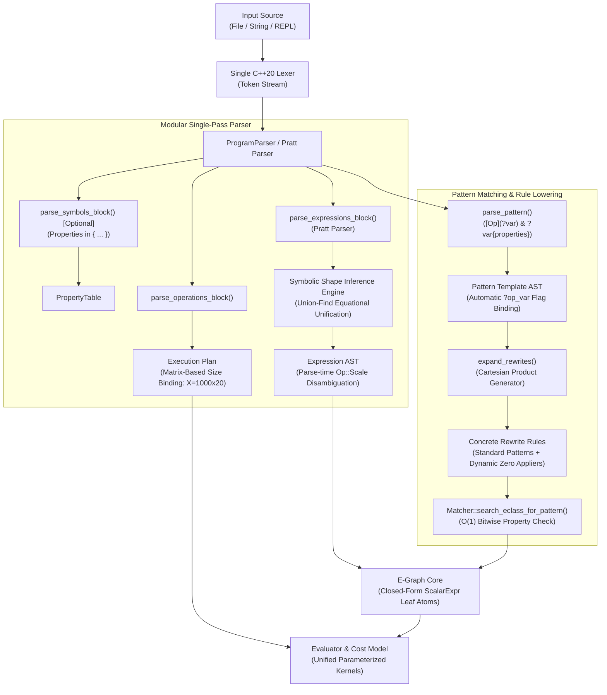

# Optional Pattern Grammar, Symbolic Shape Deduction & Unified BLAS Lowering (Clean-Slate Architecture)

* **Author:** changguo & Antigravity
* **Status:** Proposed Draft
* **Date:** 2026-10-28

--------------------------------------------------------------------------------

## Overview
This design specifies an uncompromised, clean-slate architecture for pattern matching, symbolic dimension deduction, and BLAS kernel lowering in `egraph-cpp`. Addressing the combinatorial explosion of hand-written rewrite rules in `src/rule_sets/lowering.h` and fragmented kernel enumerations in `src/core/op_registry.h`, this system unifies Level 3 BLAS operations into canonical parameterized kernels (`Op::Gemm`, `Op::Syrk`, `Op::Trsm`, `Op::Trmm`, `Op::Symm`, `Op::Gemv`) and introduces declarative pattern optionality (`[Tr](?a)`, `[+ ?c]`). 

Concurrently, the architecture introduces **automatic symbolic shape deduction** via equational Union-Find unification, rendering manual dimension declarations in the DSL optional, while establishing a clean separation between optional operator brackets (`[...]`) and property constraint tags (`{...}`). Scalar variables (such as `alpha`) are integrated into the E-Graph as closed-form leaf atoms (`ScalarExpr`), maintaining an $O(1)$ deterministic structural search during equality saturation with zero matcher backtracking and zero state space explosion.

## The Problem
The current rewrite, lowering, and shape management subsystems in `egraph-cpp` suffer from several severe architectural limitations:
1. **Combinatorial Explosion of Lowering Rules**: In `src/rule_sets/lowering.h`, lowering to BLAS requires hand-writing individual rewrite rules for every permutation of transpose flags (`NN`, `TN`, `NT`, `TT`) and bias presence (`with_c` vs. `without_c`), totaling 8 rules for GEMM alone. Adding scalar factors ($\alpha \cdot A \cdot B + \beta \cdot C$) causes an unmanageable 32-rule explosion. Similar proliferation affects `Syrk`, `Trsm`, `Trmm`, and `Symm`.
2. **Fragmented Kernel Enumerations in `OpRegistry`**: BLAS operations are artificially fragmented into separate enums (`Gemm_NN`, `Gemm_TN`, `Gemm_NT`, `Gemm_TT`, `Syrk_N`, `Syrk_T`, `Trsm_LN`, etc.). This forces `src/cost_functions/op_costs.cpp` to duplicate FLOP equations and drives `src/evaluate/evaluator.cpp` into brittle string-matching heuristics (`op_name == "Gemm_TN"`).
3. **Rigid Manual Dimension Declaration**: Users are required to invent and declare symbolic dimension identifiers manually (`A: Matrix(N, K); B: Matrix(K, M);`). This adds cognitive overhead to authoring DSL scripts and tests when dimension constraints can be deduced equationally from matrix operations.
4. **Syntactic Overloading of Brackets**: Using square brackets `[...]` for both optional grammar constructs and matrix property declarations creates lexical and visual ambiguity when matching properties on optional terms.
5. **Scalar Variable Tension**: Modeling scalar arithmetic directly as algebraic E-nodes causes combinatorial saturation explosions due to commutativity and associativity, while restricting scalars to numeric literals prevents optimizing parameterized algorithms (e.g., gradient descent with symbolic step sizes).

## Goals
* **G1: Declarative Optional Pattern Operators**: Support concise optional wrappers (`[Tr](?a)`) that automatically bind boolean flags (`?tr_a = 1/0`) and optional terms (`[+ ?c]`, `[?alpha *]`) in pattern expressions.
* **G2: Unified Property Syntax Disentanglement**: Standardize on curly braces `{...}` for property constraints across both rewrite patterns (`?a{upper, spd}`) and DSL symbol declarations (`A: Matrix{upper};`), completely freeing square brackets `[...]` for optionality.
* **G3: Automatic Symbolic Shape Deduction**: Implement equational shape inference using Disjoint-Set (Union-Find) unification across operations, making the `symbols` block optional for standard pipelines.
* **G4: Matrix-Centric Extraction Size Binding**: Allow users to bind concrete extraction dimensions by matrix name (`with sizes(X = 1000x20, W = 20x50)`), automatically resolving all inferred dimension equivalence classes.
* **G5: First-Class Closed-Form Scalar Variables**: Store scalar expressions (constants and variables) as immutable `ScalarExpr` leaf E-nodes (`ENode({}, ScalarExpr("alpha"))`) in the E-Graph, protecting equality saturation from state explosion while enabling dynamic evaluation via `DataBindings`.
* **G6: Universal BLAS Kernel Parameterization**: Collapse fragmented kernel variants into single canonical operations (`Op::Gemm`, `Op::Syrk`, `Op::Trsm`, `Op::Trmm`, `Op::Symm`, `Op::Gemv`) with standardized child operand layouts and preserved in-place buffer indices.
* **G7: Compile-Time Rule Expander (`expand_rewrites`)**: Automatically expand pattern templates into standard $O(1)$ structural rewrites, synthesizing dynamic C++ applier closures for absent bias terms to instantiate output-shape-derived zero matrices.

## Non-Goals
* **NG1: No Dynamic Matcher Backtracking**: The equality saturation engine (`Matcher::search_eclass_for_pattern`) remains strictly structural and deterministic with $O(1)$ search.
* **NG2: No 1x1 Matrix Allocation for Scalars**: Scalars will not be transformed into 1x1 matrix memory buffers in the E-Graph or BLAS evaluation routines.
* **NG3: No General Regular Expression Engine**: Patterns do not support arbitrary Kleene star (`*`) or general alternation (`|`); only binary optionality (`[ ... ]`) and property constraints (`{ ... }`) are supported.
* **NG4: No Backwards Compatibility Constraints**: Legacy enum kernels (`Gemm_NN`, `Trsm_LN`, etc.), verbose string-buffering sub-parsers, and deprecated string hacks are deleted outright.
* **NG5: No Combinatorial Cartesian Explosion**: Enforce a strict compile-time limit of $K \le 5$ optional clauses per rule definition (maximum 32 expanded rewrites).

## Resolved Design Decisions
* **D1 (Automatic Flag Binding by Convention)**: Wrapping an operator in `[Op](?var)` automatically binds an integer/boolean flag `?op_var` (`1` if present, `0` if absent), eliminating verbose alias syntax.
* **D2 (Property Bracket Disentanglement)**: Properties are enclosed strictly in `{...}`, while optional elements are enclosed strictly in `[...]`.
* **D3 (Equational Shape Inference via Union-Find)**: Matrix dimensions default to auto-generated dimension equivalence classes (`a`, `b`, `c`, ...) unified at parse time.
* **D4 (Closed-Form Scalar Leaf Atoms)**: Scalars are represented as `Atom(ScalarExpr)` inside leaf E-nodes with zero children, evaluated dynamically during concrete execution.
* **D5 (Dynamic Applier Generation for Absent Bias)**: When `[+ ?c]` is omitted, the expander generates a dynamic applier lambda that computes the output shape from the matched operands and inserts a zero matrix node.
* **D6 (Standardized ENode Children Layout)**: All kernel flags (`transA`, `side`, `uplo`) and scalar defaults (`1.0`, `0.0`) are stored in `ENode.children` as interned E-class IDs.

## Critical User Journeys (CUJs)

### CUJ 1: Concise Declarative BLAS Lowering
* **Given**: A single declarative rewrite rule in `src/rule_sets/lowering.h`:
  ```text
  expand_rewrites("gemm", "[?alpha *] [Tr](?a) * [Tr](?b) [+ [?beta *] ?c]",
                  "Gemm(?a, ?b, ?c, ?alpha, ?beta, ?tr_a, ?tr_b)")
  ```
* **When**: The lowering ruleset is initialized at engine startup.
* **Then**: `expand_rewrites` automatically expands this single template into 16 concrete rules covering all transpose, scalar, and bias permutations. Rules without `?c` automatically bind a synthesized zero matrix applier, replacing 32 hand-written rewrite rules and eliminating `Gemm_NN`, `Gemm_TN`, `Gemm_NT`, and `Gemm_TT`.

### CUJ 2: Scripting with Automatic Shape Deduction
* **Given**: A script file (`pipeline.eg`) containing an Ordinary Least Squares pipeline without a `symbols` block:
  ```text
  expressions {
      beta = Inv(Tr(X) * X) * Tr(X) * y;
  }
  operations {
      extract beta with sizes(X = 1000x20, y = 1000x1);
  }
  ```
* **When**: The user executes `egraph_cli run pipeline.eg`.
* **Then**: The engine infers all dimension relationships equationally ($\text{shape}(X) = (a, b)$, $\text{shape}(X^T X) = (b, b)$, $\text{shape}(y) = (a, c)$), maps the size bindings $a=1000, b=20, c=1$, and extracts the optimal kernel schedule.

### CUJ 3: Property-Constrained Triangular Lowering
* **Given**: Triangular solve rewrite rules in `src/rule_sets/lowering.h`:
  ```text
  expand_rewrites("trsm_left", "[?alpha *] Inv(?a{upper}) * ?b", "Trsm(?a, ?b, ?alpha, Side::Left, Uplo::Upper, 0)")
  expand_rewrites("trsm_right", "[?alpha *] ?b * Inv(?a{lower})", "Trsm(?a, ?b, ?alpha, Side::Right, Uplo::Lower, 0)")
  ```
* **When**: The E-Graph matches expressions against matrices with triangular properties.
* **Then**: The structural matcher verifies the property tags `{upper}` and `{lower}` directly against `MatrixFlags` in $O(1)$ time, dispatching to the unified `Op::Trsm` kernel.

### CUJ 4: Parameterized Optimization with Symbolic Scalars
* **Given**: An optimization pipeline with a symbolic scalar step size:
  ```text
  symbols { alpha: Scalar; }
  expressions { W_next = W - alpha * Grad; }
  operations { evaluate W_next with data(alpha = 0.01, W = "w.bin", Grad = "g.bin"); }
  ```
* **When**: The pipeline is optimized and evaluated.
* **Then**: The E-Graph preserves `alpha` as a closed-form `ScalarExpr` leaf atom during equality saturation, resolving `0.01` from `data_bindings` at execution time to pass directly to CBLAS.


--------------------------------------------------------------------------------

## Technical Plan (Architecture)

### Architectural Overview



---

### 1. Formal EBNF Grammar Specification

```ebnf
program             = [ symbols_block ] , expressions_block , operations_block ;

(* Block 1: Symbols and Property Declarations (Optional) *)
symbols_block       = "symbols" , "{" , { symbol_decl } , "}" , [ ";" ] ;
symbol_decl         = identifier , ":" , type_spec , [ property_flags ] , ";" ;
type_spec           = "Matrix" , [ "(" , dimension , "," , dimension , ")" ]
                    | "Scalar" ;
dimension           = integer_literal | identifier ;
property_flags      = "{" , identifier , { ( "," | ";" ) , identifier } , "}" ;

(* Block 2: Expressions *)
expressions_block   = "expressions" , "{" , { expression_decl } , "}" , [ ";" ] ;
expression_decl     = identifier , "=" , expr , ";" ;

expr                = term , { ( "+" | "-" ) , term } ;
term                = factor , { ( "*" | "/" ) , factor } ;
factor              = prefix_op , factor
                    | primary ;
prefix_op           = "-" ;
primary             = identifier , [ property_flags ]
                    | number_literal
                    | function_call
                    | "(" , expr , ")" ;
function_call       = identifier , "(" , [ expr_list ] , ")" ;
expr_list           = expr , { "," , expr } ;

(* Pattern Grammar for Rewrite Rules *)
pattern_expr        = pattern_term , { ( "+" | "-" ) , [ pattern_term ] } ;
pattern_term        = pattern_factor , { ( "*" | "/" ) , pattern_factor } ;
pattern_factor      = optional_wrapper
                    | pattern_var
                    | identifier , "(" , [ pattern_list ] , ")"
                    | "(" , pattern_expr , ")"
                    | number_literal
                    | identifier ;
optional_wrapper    = "[" , pattern_expr , "]" ;
pattern_var         = "?" , identifier , [ property_flags ] ;
pattern_list        = pattern_expr , { "," , pattern_expr } ;

(* Block 3: Operations Directives *)
operations_block    = "operations" , "{" , { operation_decl } , "}" , [ ";" ] ;
operation_decl      = "optimize" , identifier , [ "using" , "rulesets" , "(" , identifier_list , ")" ] , ";"
                    | "extract" , identifier , [ "greedy" ] , [ "with" , "sizes" , "(" , size_binding_list , ")" ] , ";"
                    | "evaluate" , identifier , [ "with" , "data" , "(" , data_binding_list , ")" ] , ";" ;
identifier_list     = identifier , { "," , identifier } ;
size_binding_list   = size_binding , { "," , size_binding } ;
size_binding        = identifier , "=" , ( integer_literal | matrix_shape_literal ) ;
matrix_shape_literal= integer_literal , ( "x" | "*" ) , integer_literal ;
data_binding_list   = data_binding , { "," , data_binding } ;
data_binding        = identifier , "=" , ( string_literal | number_literal ) ;
```

---

### 2. Automatic Symbolic Shape Deduction (`src/analysis/shape_inference.h`)

#### Disjoint-Set Dimension Unification
Matrix dimensions are represented as equivalence classes in a `DisjointSet` structure:
```cpp
namespace egraph {

class ShapeInferenceContext {
public:
    // Allocate fresh dimension variable
    int fresh_dimension();
    
    // Equate two dimension classes
    void unify(int dim1, int dim2);
    
    // Assign canonical letter ('a', 'b', ...) to each root class
    void assign_canonical_symbols();
    
    // Resolve concrete size bindings by matrix name (e.g. X = 1000x20)
    SizeBindings resolve_bindings(const std::unordered_map<std::string, std::pair<int, int>> &matrix_sizes) const;

private:
    std::vector<int> parent;
    std::unordered_map<int, std::string> canonical_names;
};

} // namespace egraph
```

#### Equational Unification Rules across AST Nodes
1. **Matrix Multiplication (`A * B`)**:
   $$\text{unify}(\text{cols}(A), \text{rows}(B))$$
   $$\text{shape}(A * B) = (\text{rows}(A), \text{cols}(B))$$
2. **Matrix Addition / Subtraction (`A + B`)**:
   $$\text{unify}(\text{rows}(A), \text{rows}(B)), \quad \text{unify}(\text{cols}(A), \text{cols}(B))$$
   $$\text{shape}(A \pm B) = (\text{rows}(A), \text{cols}(A))$$
3. **Transpose (`Tr(A)`)**:
   $$\text{shape}(Tr(A)) = (\text{cols}(A), \text{rows}(A))$$
4. **Inverse (`Inv(A)`)**:
   $$\text{unify}(\text{rows}(A), \text{cols}(A)), \quad \text{shape}(Inv(A)) = \text{shape}(A)$$
5. **Square / Symmetric Property (`A{square}` or `A{symmetric}`)**:
   $$\text{unify}(\text{rows}(A), \text{cols}(A))$$

---

### 3. Pattern Expansion Subsystem (`src/rewrite/rewriter.h`)

#### Automatic Flag Binding by Convention
When the expander encounters `[Op](?var)`:
* The flag variable is automatically derived as `?op_var` (e.g. `[Tr](?a)` $\implies `?tr_a`).
* In the active branch (where `Tr` matched): `?tr_a` is bound to an interned E-node `1`.
* In the bypassed branch (where `Tr` was absent): `?tr_a` is bound to an interned E-node `0`.

#### Cartesian Expansion Factory (`expand_rewrites`)
```cpp
namespace egraph {

std::vector<Rewrite> expand_rewrites(
    std::string_view name,
    std::string_view lhs_template,
    std::string_view rhs_template,
    bool bidirectional = false,
    std::function<bool(const EGraph &, const Substitution &)> condition = nullptr,
    size_t initial_match_limit = 30);

} // namespace egraph
```

#### Dynamic Applier Synthesis for Absent Bias Terms
For expanded rule permutations where `[+ ?c]` is omitted on the LHS:
The expander synthesizes a dynamic C++ applier lambda that derives the output shape from the matched operands and inserts an exact zero matrix node:
```cpp
[](EGraph &g, const Substitution &s, Id _) -> std::pair<Id, bool> {
    Id a_id = s.at("a");
    Id b_id = s.at("b");
    const auto *a_prop = get_matrix_data(g, a_id);
    const auto *b_prop = get_matrix_data(g, b_id);
    int tr_a = s.count("tr_a") ? get_int_from_eclass(g, s.at("tr_a")).value_or(0) : 0;
    int tr_b = s.count("tr_b") ? get_int_from_eclass(g, s.at("tr_b")).value_or(0) : 0;
    
    Size out_rows = (tr_a == 0) ? a_prop->shape.first : a_prop->shape.second;
    Size out_cols = (tr_b == 0) ? b_prop->shape.second : b_prop->shape.first;
    Id zero_id = make_zero_of_shape(g, {out_rows, out_cols});
    
    Id alpha_id = s.count("alpha") ? s.at("alpha") : g.add_node(ENode({}, ScalarExpr(1.0)));
    Id beta_id = g.add_node(ENode({}, ScalarExpr(0.0)));
    Id ta_id = s.count("tr_a") ? s.at("tr_a") : g.add_node(ENode({}, 0));
    Id tb_id = s.count("tr_b") ? s.at("tr_b") : g.add_node(ENode({}, 0));
    
    ENode gemm_node({a_id, b_id, zero_id, alpha_id, beta_id, ta_id, tb_id}, OpRegistry::op("Gemm"));
    return std::make_pair(g.add_node(gemm_node), false);
}
```

---

### 4. Property Tag Verification in `Matcher` (`src/rewrite/matcher.cpp`)

#### Canonical Property Tag Catalog
Tags declared in `{...}` map directly to `MatrixProperty.flags`:
* `upper` $\implies$ `flags.is_upper_triangular`
* `lower` $\implies$ `flags.is_lower_triangular`
* `symmetric` $\implies$ `flags.is_symmetric`
* `diagonal` $\implies$ `flags.is_diagonal`
* `spd` $\implies$ `flags.is_positive_definite`
* `fullrank` $\implies$ `flags.is_full_rank`
* `nonsingular` $\implies$ `flags.is_non_singular`
* `orthogonal` $\implies$ `flags.is_orthogonal`
* `square` $\implies$ `is_square()`
* `vector` $\implies$ `is_vector()`

#### Bitwise Matcher Verification
In `Matcher::search_eclass_for_pattern`, property tags on pattern variables are evaluated in $O(1)$ time:
```cpp
bool Matcher::validate_property_constraints(Id eclass_id, const std::vector<PropertyTag> &tags) const {
    const auto &class_data = egraph.get_class_analysis_data(eclass_id);
    const auto *prop = std::get_if<MatrixProperty>(&class_data.property);
    if (!prop) return false;
    for (const auto &tag : tags) {
        if (!tag.test(*prop)) return false;
    }
    return true;
}
```

---

### 5. Universal BLAS Kernel Parameterization in `OpRegistry`

All fragmented BLAS kernel enumerations in `src/core/op_registry.h` are collapsed into unified operations. Children vectors in `ENode` strictly store E-class `Id`s:

| Unified Op | Child Operands Layout | in_place_input | Collapsed Legacy Ops |
| :--- | :--- | :--- | :--- |
| **`Op::Gemm`** | `[A, B, C, alpha, beta, transA, transB]` | `2` (`C`) | `Gemm_NN`, `Gemm_TN`, `Gemm_NT`, `Gemm_TT` |
| **`Op::Syrk`** | `[A, C, alpha, beta, trans]` | `1` (`C`) | `Syrk_N`, `Syrk_T` |
| **`Op::Trsm`** | `[A, B, alpha, side, uplo, trans]` | `1` (`B`) | `Trsm_LN`, `Trsm_LT`, `Trsm_RN`, `Trsm_RT` |
| **`Op::Trmm`** | `[A, B, alpha, side, uplo, trans]` | `1` (`B`) | `Trmm_LN`, `Trmm_LT`, `Trmm_RN`, `Trmm_RT` |
| **`Op::Symm`** | `[A, B, C, alpha, beta, side]` | `2` (`C`) | `Symm_L`, `Symm_R` |
| **`Op::Gemv`** | `[A, x, y, alpha, beta, trans]` | `2` (`y`) | `Gemv_N`, `Gemv_T` |

#### Interned Constant E-Nodes
- Flags (`transA`, `side`, `uplo`) are interned as constant integer E-nodes (`Atom(int)`).
- Scalars (`alpha`, `beta`) are interned as scalar constant E-nodes (`Atom(ScalarExpr)` or `Atom(double)`).
- `init_operands` dynamically unpacks `Children` into strongly typed `MatrixOperand`, `IndexOperand`, and `ScalarOperand` variants.

---

### 6. Closed-Form Scalar Representation (`ScalarExpr`)

```cpp
struct ScalarExpr {
    ScalarOp op = ScalarOp::Value;
    double val = 0.0;
    std::string var; // Upgraded from single char
    std::vector<ScalarExpr> children;
    
    ScalarExpr() = default;
    explicit ScalarExpr(double v) : op(ScalarOp::Value), val(v) {}
    explicit ScalarExpr(std::string v) : op(ScalarOp::Var), var(std::move(v)) {}
    ScalarExpr(ScalarOp op, std::vector<ScalarExpr> children)
        : op(op), children(std::move(children)) {}
    
    double evaluate(const DataBindings &bindings, const SizeBindings &sizes = {}) const;
    std::string to_string() const;
};
```

---

### 7. Consolidated CBLAS Evaluation (`src/evaluate/evaluator.cpp`)

All string-parsing heuristics are eliminated. Kernel evaluators read strongly typed operands directly:
```cpp
void eval_gemm(
    std::string_view /*op_name*/, const std::vector<Operand> &operands,
    const std::vector<const MatrixNode *> &inputs, MatrixNode &output,
    const DataBindings &data_bindings) {
    
    inputs[0]->ensure_general();
    inputs[1]->ensure_general();
    
    CBLAS_TRANSPOSE transA = (*as_index(operands[5]) == 1) ? CblasTrans : CblasNoTrans;
    CBLAS_TRANSPOSE transB = (*as_index(operands[6]) == 1) ? CblasTrans : CblasNoTrans;
    
    double alpha = as_scalar(operands[3]).value_or(1.0);
    double beta = as_matrix(operands[2])->is_zero() ? 0.0 : as_scalar(operands[4]).value_or(1.0);
    
    int k = (transA == CblasNoTrans) ? inputs[0]->cols : inputs[0]->rows;
    cblas_dgemm(CblasColMajor, transA, transB, output.rows, output.cols, k, alpha,
                inputs[0]->data(), inputs[0]->rows, inputs[1]->data(), inputs[1]->rows,
                beta, output.data(), output.rows);
}
```


--------------------------------------------------------------------------------

## Alternatives Considered

### Alternative 1: Dynamic Matcher Backtracking for Optional Patterns
* **Description**: Storing `Optional` pattern nodes directly in the `Pattern` AST and modifying `Matcher::search_eclass_for_pattern` to branch dynamically during equality saturation.
* **Reason for Rejection**: Non-deterministic recursive search inside the hottest loop of equality saturation degrades saturation throughput. It adds significant complexity to `Substitution` tracking (differentiating between unassigned, defaulted, and matched variables) and makes rule scheduling non-deterministic. Compile-time Cartesian expansion produces standard, deterministic $O(1)$ rewrites while adding less than 20 KB of RAM overhead.

### Alternative 2: Mandatory Explicit Dimension Declarations (`symbols` block)
* **Description**: Requiring every matrix symbol and symbolic dimension letter (`N, K, M`) to be declared explicitly in a mandatory Block 1 before use.
* **Reason for Rejection**: Imposes unnecessary cognitive overhead on script authors and test writers when dimension relationships can be deduced equationally via Union-Find unification. Making the `symbols` block optional and inferring dimensions automatically simplifies scripting while preserving explicit declarations when needed.

### Alternative 3: First-Class Algebraic Scalar E-Nodes
* **Description**: Modeling scalar arithmetic (`alpha + beta`, `2.0 * alpha`) as first-class E-nodes in the E-Graph with commutative, associative, and distributive rewrite rules.
* **Reason for Rejection**: Causes severe combinatorial state space explosion in the E-Graph for trivial scalar algebra. Retaining closed-form `ScalarExpr` leaf atoms isolates scalar expressions from matrix graph explosion while enabling dynamic evaluation via `DataBindings`.

### Alternative 4: Combinatorial Enum Kernel Variants (`Gemm_NN`, `Gemm_TN`, etc.)
* **Description**: Keeping separate enumerations for each permutation of flags (`Gemm_NN`, `Gemm_TN`, `Gemm_NT`, `Gemm_TT`, `Syrk_N`, `Syrk_T`, `Trsm_LN`, etc.).
* **Reason for Rejection**: Leads to extreme rule bloat (32 rules for full GEMM), duplicates FLOP cost equations across `op_costs.cpp`, and forces `evaluator.cpp` into brittle string-matching heuristics (`op_name == "Gemm_TN"`). Parameterized unified kernels collapse dispatch down to single, maintainable routines.

### Alternative 5: Overloading Square Brackets for Both Optionality and Properties
* **Description**: Using square brackets `[...]` for both optional operations (`[Tr](?a)`) and matrix property tags (`?a[upper]`).
* **Reason for Rejection**: Creates visual clutter and lexical ambiguities when property tags appear inside optional operator wrappers (e.g. `[Tr](?a[upper])`). Disentangling properties into curly braces `{...}` creates clean, unambiguous grammar boundaries across both pattern matching and DSL declarations.


--------------------------------------------------------------------------------

## Detailed Implementation Plan

### Target Files to Create / Modify

#### 1. `src/core/basic_types.h` (Modify)
* **Scope**: Core Data Structures
* **Rationale**: Enable descriptive scalar variable identifiers (e.g. `alpha`, `beta`, `step_size`).
* **Proposed Changes**:
  - Replace `char var = '\0';` with `std::string var;` in `struct ScalarExpr`.
  - Update `ScalarExpr` constructors to accept `std::string`.
  - Update equality and relational operators (`operator==`, `operator<`) to compare `std::string var`.
  - Update `ScalarExpr::evaluate(data_bindings)` to query `std::string` keys.

#### 2. `src/core/op_registry.h` and `src/core/op_registry.cpp` (Modify)
* **Scope**: Kernel Registry & Operand Abstraction
* **Rationale**: Collapse combinatorial enum kernel variants into unified parameterized operations.
* **Proposed Changes**:
  - Delete legacy enumerations: `Gemm_NN`, `Gemm_TN`, `Gemm_NT`, `Gemm_TT`, `Syrk_N`, `Syrk_T`, `Trsm_LN`, `Trsm_LT`, `Trsm_RN`, `Trsm_RT`, `Trmm_LN`, `Trmm_LT`, `Trmm_RN`, `Trmm_RT`, `Symm_L`, `Symm_R`, `Gemv_N`, `Gemv_T`.
  - Register canonical unified ops: `Op::Gemm`, `Op::Syrk`, `Op::Trsm`, `Op::Trmm`, `Op::Symm`, `Op::Gemv`.
  - Enforce standardized child operand layouts and in-place buffer reuse indices:
    - `Op::Gemm`: `[A, B, C, alpha, beta, transA, transB]` with `in_place_input = 2` (`C`).
    - `Op::Syrk`: `[A, C, alpha, beta, trans]` with `in_place_input = 1` (`C`).
    - `Op::Trsm`: `[A, B, alpha, side, uplo, trans]` with `in_place_input = 1` (`B`).
    - `Op::Trmm`: `[A, B, alpha, side, uplo, trans]` with `in_place_input = 1` (`B`).
    - `Op::Symm`: `[A, B, C, alpha, beta, side]` with `in_place_input = 2` (`C`).
    - `Op::Gemv`: `[A, x, y, alpha, beta, trans]` with `in_place_input = 2` (`y`).

#### 3. `src/analysis/shape_inference.h` and `src/analysis/shape_inference.cpp` (Create)
* **Scope**: Equational Dimension Unification
* **Rationale**: Deduce matrix shapes automatically via Union-Find, making `symbols` block optional.
* **Proposed Changes**:
  - Implement `ShapeInferenceContext` with Disjoint-Set Union-Find data structures.
  - Implement unification logic for matrix multiplication (`cols(A) == rows(B)`), addition (`shape(A) == shape(B)`), transpose, and inverse.
  - Implement canonical symbol assignment (`a`, `b`, `c`, ...) for disjoint dimension equivalence classes.
  - Implement matrix-based size binding resolution (`with sizes(X = 1000x20, W = 20x50)`).

#### 4. `src/common/parser.h` and `src/common/parser.cpp` (Modify)
* **Scope**: Lexer & Pratt Parser Engine
* **Rationale**: Parse optional pattern wrappers, property constraint tags, and matrix size bindings.
* **Proposed Changes**:
  - Update Lexer to tokenize `{` and `}` for property tags, and recognize matrix size literals (`1000x20`).
  - Make `symbols` block optional in `parse_program()`.
  - Integrate `ShapeInferenceContext` into expression parsing to infer dimensions when `PropertyTable` declarations are absent.
  - In pattern mode, parse `[ pattern_expr ]` into `OptionalPatternNode`, auto-deriving flag variables (`?tr_a`).
  - In pattern mode, parse `?var{flag1, flag2}` into pattern variable property constraints.
  - In operations block, parse matrix-based size bindings (`identifier = integer x integer`).

#### 5. `src/rewrite/pattern.h` and `src/rewrite/pattern.cpp` (Modify)
* **Scope**: Pattern AST Structures
* **Rationale**: Represent optional clauses and property constraints in the pattern AST.
* **Proposed Changes**:
  - Define `struct PropertyTag` containing canonical flag bits and verification predicates.
  - Add `std::vector<PropertyTag> property_tags;` to pattern variable representations.
  - Add `struct OptionalPatternNode` for template representation prior to expansion.

#### 6. `src/rewrite/rewriter.h` and `src/rewrite/rewriter.cpp` (Modify)
* **Scope**: Rule Expander Subsystem
* **Rationale**: Expand pattern templates containing optional elements into concrete rewrites with dynamic appliers.
* **Proposed Changes**:
  - Implement `expand_rewrites(name, lhs_template, rhs_template, bidirectional, condition, match_limit)`.
  - Implement Cartesian product generation for $K \le 5$ optional clauses.
  - For branches without `?c`, synthesize dynamic C++ appliers that call `make_zero_of_shape` to construct shape-derived zero matrix nodes.
  - Intern constant boolean/integer flags (`0`, `1`) and default scalars (`1.0`, `0.0`) in the E-Graph.

#### 7. `src/rewrite/matcher.h` and `src/rewrite/matcher.cpp` (Modify)
* **Scope**: Structural Pattern Matcher
* **Rationale**: Fast $O(1)$ validation of property tags against `MatrixProperty.flags`.
* **Proposed Changes**:
  - Implement `validate_property_constraints(Id eclass_id, const std::vector<PropertyTag> &tags)` in `Matcher`.
  - Validate flags (`is_upper_triangular`, `is_symmetric`, `is_positive_definite`, etc.) using bitwise operations without intermediate string allocations.

#### 8. `src/evaluate/evaluator.cpp` (Modify)
* **Scope**: CBLAS Execution Dispatch
* **Rationale**: Dispatch unified kernels directly via strongly typed operands and evaluate variable scalars.
* **Proposed Changes**:
  - Consolidate `eval_gemm_group` into a single routine reading `as_index(operands[5])` (`transA`) and `as_index(operands[6])` (`transB`).
  - Consolidate `eval_trsm_group`, `eval_trmm_group`, `eval_syrk_group`, and `eval_symm_group`.
  - In `eval_gemm`, evaluate symbolic `ScalarExpr` operands against `data_bindings` via `scalar_expr.evaluate(data_bindings)` before passing `double` to `cblas_dgemm`.

#### 9. `src/cost_functions/op_costs.cpp` (Modify)
* **Scope**: Cost Modeling
* **Rationale**: Consolidate redundant FLOP cost formulas across kernel enumerations.
* **Proposed Changes**:
  - Consolidate GEMM cost calculation down to a single formula parameterized by $M, N, K$.
  - Consolidate SYRK, TRSM, TRMM, and SYMM cost formulas.

#### 10. `src/rule_sets/lowering.h` (Modify)
* **Scope**: BLAS Lowering Ruleset
* **Rationale**: Replace 20+ fragmented rewrite rules with concise declarative `expand_rewrites` calls.
* **Proposed Changes**:
  - Replace 8 manual GEMM rules with 1 `expand_rewrites("gemm", ...)` declaration.
  - Replace SYRK rules with 1 `expand_rewrites("syrk", ...)` declaration.
  - Replace TRSM rules with 2 declarative rules (`trsm_left` and `trsm_right`).
  - Replace TRMM rules with 2 declarative rules (`trmm_left` and `trmm_right`).

#### 11. `tests/unit/shape_inference_test.cpp` (Create)
* **Scope**: Unit Tests
* **Rationale**: Test equational shape deduction and size binding.
* **Proposed Changes**:
  - Test matrix chain multiplication dimension unification ($A \cdot B \cdot C$).
  - Test dimension mismatch error detection.
  - Test matrix-based size binding (`X = 1000x20`).

#### 12. `tests/unit/pattern_expansion_test.cpp` (Create)
* **Scope**: Unit Tests
* **Rationale**: Test pattern macro expansion and dynamic zero-matrix appliers.
* **Proposed Changes**:
  - Test Cartesian expansion generating exact permutations ($2^K$).
  - Test automatic flag binding (`?tr_a = 1/0`).
  - Test dynamic applier instantiating zero matrices of correct shape when `+ ?c` is absent.
  - Test safety limit rejection when $K > 5$.

#### 13. `tests/unit/lowering_test.cpp` (Modify)
* **Scope**: Integration Tests
* **Rationale**: Verify end-to-end lowering to unified kernels.
* **Proposed Changes**:
  - Test lowering expressions to `Op::Gemm`, asserting on operand layout, transpose flags, and scalar factors.
  - Test lowering expressions with triangular constraints (`Inv(A{upper}) * B`) to `Op::Trsm`.

#### 14. `docs/GRAMMAR.md` (Create / Modify)
* **Scope**: Specification Documentation
* **Rationale**: Authoritative reference for the 3-block DSL, optional pattern syntax, and property tags.

---

### Verification Plan

* **Compilation & Build**:
  ```bash
  cmake -G Ninja -S . -B build -DCMAKE_BUILD_TYPE=Release
  cmake --build build --target egraph_core_lib egraph_cli unit_tests
  ```
* **Comprehensive Test Suite**:
  ```bash
  ctest --test-dir build --output-on-failure
  ```
  *Requirement: 100% pass rate across existing test suites and all new shape inference and pattern expansion tests.*
* **End-to-End CLI Pipeline Verification**:
  ```bash
  ./build/bin/egraph_cli run tests/fixtures/ols_auto_shape.eg
  ```
* **Memory & Address Sanitization (ASan / UBSan)**:
  ```bash
  cmake -B build_asan -DENABLE_ASAN=ON
  cmake --build build_asan --target unit_tests
  ctest --test-dir build_asan --output-on-failure
  ```
