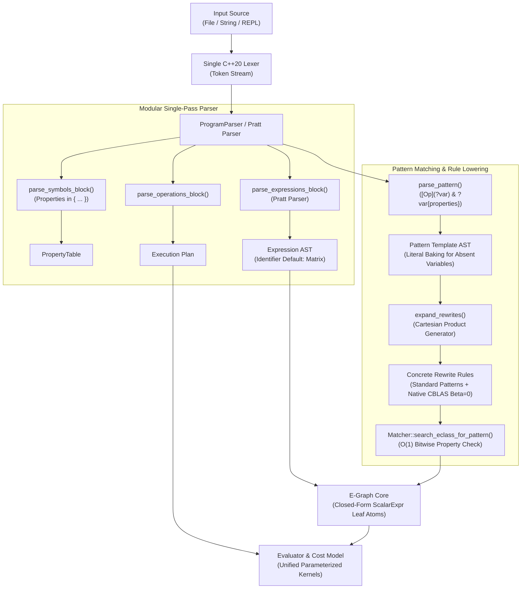

# Optional Pattern Grammar, Closed-Form Scalar Representation & Unified BLAS Lowering (Clean-Slate Architecture)

* **Author:** changguo & Antigravity
* **Status:** Proposed Draft
* **Date:** 2026-10-28

--------------------------------------------------------------------------------

## Overview
This design specifies an uncompromised, clean-slate architecture for pattern matching, scalar representation, and BLAS kernel lowering in `egraph-cpp`. Addressing the combinatorial explosion of hand-written rewrite rules in `src/rule_sets/lowering.h` and fragmented kernel enumerations in `src/core/op_registry.h`, this system unifies Level 2 and Level 3 BLAS operations into canonical parameterized kernels (`Op::Gemm`, `Op::Syrk`, `Op::Trsm`, `Op::Trmm`, `Op::Symm`, `Op::Gemv`) and introduces declarative pattern optionality (`[Tr](?a)`, `[+ ?c]`). 

Concurrently, the architecture establishes a clean separation between optional operator brackets (`[...]`) and property constraint tags (`{...}`). Scalar variables (such as `alpha`) are integrated into the E-Graph as closed-form leaf atoms (`ScalarExpr`), maintaining an $O(1)$ deterministic structural search during equality saturation with zero matcher backtracking and zero state space explosion. Automatic shape deduction is decoupled into a dedicated subsequent frontend RFC, retaining explicit `symbols` block declarations for matrix dimensions in this document.

## The Problem
The current rewrite, lowering, and shape management subsystems in `egraph-cpp` suffer from several severe architectural limitations:
1. **Combinatorial Explosion of Lowering Rules**: In `src/rule_sets/lowering.h`, lowering to BLAS requires hand-writing individual rewrite rules for every permutation of transpose flags (`NN`, `TN`, `NT`, `TT`) and bias presence (`with_c` vs. `without_c`), totaling 8 rules for GEMM alone. Adding scalar factors ($\alpha \cdot A \cdot B + \beta \cdot C$) causes an unmanageable 32-rule explosion. Similar proliferation affects `Syrk`, `Trsm`, `Trmm`, and `Symm`.
2. **Fragmented Kernel Enumerations in `OpRegistry`**: BLAS operations are artificially fragmented into separate enums (`Gemm_NN`, `Gemm_TN`, `Gemm_NT`, `Gemm_TT`, `Syrk_N`, `Syrk_T`, `Trsm_LN`, etc.). This forces `src/cost_functions/op_costs.cpp` to duplicate FLOP equations and drives `src/evaluate/evaluator.cpp` into brittle string-matching heuristics (`op_name == "Gemm_TN"`).
3. **Rigid Manual Dimension Declaration**: Current workflows require declaring symbolic dimension identifiers manually (`A: Matrix(N, K); B: Matrix(K, M);`). While equational shape deduction will be addressed in a future frontend RFC, lowering rules must not introduce additional dimension burdens.
4. **Syntactic Overloading of Brackets**: Using square brackets `[...]` for both optional grammar constructs and matrix property declarations creates lexical and visual ambiguity when matching properties on optional terms.
5. **Scalar Variable Tension**: Modeling scalar arithmetic directly as algebraic E-nodes causes combinatorial saturation explosions due to commutativity and associativity, while restricting scalars to numeric literals prevents optimizing parameterized algorithms (e.g., gradient descent with symbolic step sizes).

## Goals
* **G1: Declarative Optional Pattern Operators**: Support concise optional wrappers (`[Tr](?a)`) that automatically bind boolean flags (`?tr_a = 1/0`) and optional terms (`[+ ?c]`, `[?alpha *]`) in pattern expressions.
* **G2: Unified Property Syntax Disentanglement**: Standardize on curly braces `{...}` for property constraints across both rewrite patterns (`?a{upper, spd}`) and DSL symbol declarations (`A: Matrix{upper};`), completely freeing square brackets `[...]` for optionality.
* **G3: First-Class Closed-Form Scalar Variables**: Store scalar expressions (constants and variables) as immutable `ScalarExpr` leaf E-nodes (`ENode({}, ScalarExpr("alpha"))`) in the E-Graph, protecting equality saturation from state explosion while enabling dynamic evaluation via `DataBindings`.
* **G4: Universal BLAS Kernel Parameterization**: Collapse fragmented kernel variants into single canonical operations (`Op::Gemm`, `Op::Syrk`, `Op::Trsm`, `Op::Trmm`, `Op::Symm`, `Op::Gemv`) with standardized child operand layouts and preserved in-place buffer indices.
* **G5: Compile-Time Rule Expander (`expand_rewrites`)**: Automatically expand pattern templates into standard $O(1)$ structural rewrites, baking default literals into target RHS templates without runtime matcher overhead or synthetic zero matrix allocations.

## Non-Goals
* **NG1: No Dynamic Matcher Backtracking**: The equality saturation engine (`Matcher::search_eclass_for_pattern`) remains strictly structural and deterministic with $O(1)$ search.
* **NG2: No 1x1 Matrix Allocation for Scalars**: Scalars will not be transformed into 1x1 matrix memory buffers in the E-Graph or BLAS evaluation routines.
* **NG3: No General Regular Expression Engine**: Patterns do not support arbitrary Kleene star (`*`) or general alternation (`|`); only binary optionality (`[ ... ]`) and property constraints (`{ ... }`) are supported.
* **NG4: No Backwards Compatibility Constraints**: Legacy enum kernels (`Gemm_NN`, `Trsm_LN`, etc.), verbose string-buffering sub-parsers, and deprecated string hacks are deleted outright.
* **NG5: No Combinatorial Cartesian Explosion**: Enforce a strict compile-time limit of $K \le 5$ optional clauses per rule definition (maximum 32 expanded rewrites).
* **NG6: Decouple Frontend Shape Inference**: Automatic equational shape deduction via Union-Find is deferred to a dedicated frontend RFC; this document retains explicit `symbols` dimension declarations.

## Resolved Design Decisions
* **D1 (Automatic Flag Binding by Convention)**: Wrapping an operator in `[Op](?var)` automatically binds an integer/boolean flag `?op_var` (`1` if present, `0` if absent), eliminating verbose alias syntax.
* **D2 (Property Bracket Disentanglement)**: Properties are enclosed strictly in `{...}`, while optional elements are enclosed strictly in `[...]`.
* **D3 (Closed-Form Scalar Leaf Atoms)**: Scalars are represented as `Atom(ScalarExpr)` inside leaf E-nodes with zero children, evaluated dynamically during concrete execution.
* **D4 (Native CBLAS Zero Bias Representation)**: When `[+ ?c]` is omitted, bias is represented via $\beta = 0.0$ natively. No synthetic zero matrices or procedural lambdas are generated; CBLAS does not read $C$ when $\beta = 0.0$.
* **D5 (Standardized ENode Children Layout)**: All kernel flags (`transA`, `side`, `uplo`) and scalar defaults (`1.0`, `0.0`) are stored in `ENode.children` as interned E-class IDs.

## Critical User Journeys (CUJs)

### CUJ 1: Concise Declarative BLAS Lowering
* **Given**: A single declarative rewrite rule in `src/rule_sets/lowering.h`:
  ```text
  expand_rewrites("gemm", "[?alpha *] [Tr](?a) * [Tr](?b) [+ [?beta *] ?c]",
                  "Gemm(?a, ?b, ?c, ?alpha, ?beta, ?tr_a, ?tr_b)")
  ```
* **When**: The lowering ruleset is initialized at engine startup.
* **Then**: `expand_rewrites` automatically expands this single template into 16 concrete rules covering all transpose, scalar, and bias permutations. Rules without `?c` automatically bake literal `0.0` for $\beta$ into the RHS pattern string and omit $C$, replacing 32 hand-written rewrite rules and eliminating `Gemm_NN`, `Gemm_TN`, `Gemm_NT`, and `Gemm_TT`.

### CUJ 2: Parameterized Optimization with Symbolic Scalars
* **Given**: An optimization pipeline with a symbolic scalar step size:
  ```text
  symbols {
      alpha: Scalar;
      W: Matrix(100, 100);
      Grad: Matrix(100, 100);
  }
  expressions {
      W_next = W - alpha * Grad;
  }
  operations {
      evaluate W_next with data(alpha = 0.01, W = "w.bin", Grad = "g.bin");
  }
  ```
* **When**: The pipeline is optimized and evaluated.
* **Then**: The E-Graph preserves `alpha` as a closed-form `ScalarExpr` leaf atom during equality saturation, resolving `0.01` from `data_bindings` at execution time to pass directly to CBLAS.

### CUJ 3: Property-Constrained Triangular Lowering
* **Given**: Triangular solve rewrite rules in `src/rule_sets/lowering.h`:
  ```text
  expand_rewrites("trsm_left", "[?alpha *] Inv(?a{upper}) * ?b", "Trsm(?a, ?b, ?alpha, Side::Left, Uplo::Upper, 0)")
  expand_rewrites("trsm_right", "[?alpha *] ?b * Inv(?a{lower})", "Trsm(?a, ?b, ?alpha, Side::Right, Uplo::Lower, 0)")
  ```
* **When**: The E-Graph matches expressions against matrices with triangular properties.
* **Then**: The structural matcher verifies the property tags `{upper}` and `{lower}` directly against `MatrixFlags` in $O(1)$ time, dispatching to the unified `Op::Trsm` kernel.

--------------------------------------------------------------------------------

## Technical Plan (Architecture)

### Architectural Overview



    DirectExpr --> EGraphCore["E-Graph Core<br/>(Closed-Form ScalarExpr Leaf Atoms)"]
    MatcherCore --> EGraphCore
    Plan --> EvaluatorCore["Evaluator & Cost Model<br/>(Unified Parameterized Kernels)"]
    EGraphCore --> EvaluatorCore
```

---

### 1. Formal EBNF Grammar Specification

```ebnf
program             = symbols_block , expressions_block , operations_block ;

(* Block 1: Symbols and Property Declarations *)
symbols_block       = "symbols" , "{" , { symbol_decl } , "}" , [ ";" ] ;
symbol_decl         = identifier , ":" , type_spec , [ property_flags ] , ";" ;
type_spec           = "Matrix" , "(" , dimension , "," , dimension , ")"
                    | "Scalar" ;
dimension           = integer_literal | identifier ;
property_flags      = "{" , identifier , { ( "," | ";" ) , identifier } , "}" ;

(* Block 2: Expressions *)
expressions_block   = "expressions" , "{" , { expression_decl } , "}" , [ ";" ] ;
expression_decl     = identifier , "=" , expr , ";" ;

expr                = term , { ( "+" | "-" ) , term } ;
term                = factor , { ( "*" | "/" ) , factor } ;
factor              = prefix_op , factor
                    | primary ;
prefix_op           = "-" ;
primary             = identifier , [ property_flags ]
                    | number_literal
                    | function_call
                    | "(" , expr , ")" ;
function_call       = identifier , "(" , [ expr_list ] , ")" ;
expr_list           = expr , { "," , expr } ;

(* Pattern Grammar for Rewrite Rules *)
pattern_expr        = [ ( "+" | "-" ) ] , pattern_term , { ( "+" | "-" ) , pattern_term } ;
pattern_term        = pattern_factor , { ( "*" | "/" ) , pattern_factor } ;
pattern_factor      = optional_op_call
                    | optional_clause
                    | pattern_var
                    | identifier , "(" , [ pattern_list ] , ")"
                    | "(" , pattern_expr , ")"
                    | number_literal
                    | identifier ;
optional_op_call    = "[" , identifier , "]" , "(" , pattern_list , ")" ;
optional_clause     = "[" , ( "+" | "-" ) , pattern_expr , "]"
                    | "[" , pattern_expr , ( "*" | "/" ) , "]"
                    | "[" , pattern_expr , "]" ;
pattern_var         = "?" , identifier , [ property_flags ] ;
pattern_list        = pattern_expr , { "," , pattern_expr } ;

(* Block 3: Operations Directives *)
operations_block    = "operations" , "{" , { operation_decl } , "}" , [ ";" ] ;
operation_decl      = "optimize" , identifier , [ "using" , "rulesets" , "(" , identifier_list , ")" ] , ";"
                    | "extract" , identifier , [ "greedy" ] , ";"
                    | "evaluate" , identifier , [ "with" , "data" , "(" , data_binding_list , ")" ] , ";" ;
identifier_list     = identifier , { "," , identifier } ;
data_binding_list   = data_binding , { "," , data_binding } ;
data_binding        = identifier , "=" , ( string_literal | number_literal ) ;
```

---

### 2. Dimension Consistency & Frontend Decoupling

In this architecture, dimension validation and matrix metadata build upon the explicit `symbols` block established in the Pratt parser specification (`src/analysis/analysis.h` and `PropertyTable`). Dimensions and types are explicitly declared:
```text
symbols {
    A: Matrix(M, K);
    B: Matrix(K, N);
    C: Matrix(M, N);
    alpha: Scalar;
}
```
During pattern matching and kernel lowering, dimension compatibility is validated against the e-class `MatrixProperty.shape` maintained by `Analysis`.

> [!NOTE] Scope Decoupling
> Automatic equational shape deduction via Disjoint-Set (Union-Find) unification and matrix-based size binding syntax (`with sizes(...)`) are decoupled from this BLAS lowering document. They are deferred to a dedicated subsequent frontend RFC to keep the compiler lowering changes focused, verifiable, and minimal.

---

### 3. Pattern Expansion Subsystem (`src/rewrite/rewriter.h`)

#### Automatic Flag Binding & Literal Baking
When `expand_rewrites` encounters optional clauses in pattern templates, it expands them into concrete rewrite rules at compile time via Cartesian product generation. To ensure standard $O(1)$ structural pattern matching without runtime substitution failures:
* **Optional Operator Calls (`[Op](?var)`)**:
  - Derived flag: `?op_var` (e.g., `[Tr](?a)` $\implies `?tr_a`).
  - Active branch (where `Op` is matched): `?tr_a` is replaced by integer literal `1` in the RHS pattern template.
  - Bypassed branch (where `Op` is omitted): `?tr_a` is replaced by integer literal `0` in the RHS pattern template.
* **Optional Scalar Factors (`[?alpha *]`, `[?beta *]`)**:
  - Matched branch: RHS retains the variable reference (`?alpha`, `?beta`).
  - Omitted branch: RHS receives literal `1.0` directly baked into the rewrite pattern string.
* **Optional Bias (`[+ ?c]`)**:
  - Matched branch: RHS references `?c` and scalar `?beta`.
  - Omitted branch: RHS receives literal `0.0` for $\beta$ and a sentinel operand for $C$.

#### Cartesian Expansion Factory (`expand_rewrites`)
```cpp
namespace egraph {

std::vector<Rewrite> expand_rewrites(
    std::string_view name,
    std::string_view lhs_template,
    std::string_view rhs_template,
    bool bidirectional = false,
    std::function<bool(const EGraph &, const Substitution &)> condition = nullptr,
    size_t initial_match_limit = 30);

} // namespace egraph
```

#### Native CBLAS Zero Bias Representation
In CBLAS, an absent bias matrix is natively represented by setting scalar $\beta = 0.0$. In Level 3 BLAS routines like `cblas_dgemm`, when $\beta = 0.0$, matrix $C$ is strictly an output buffer and its input contents are never read.

Consequently, dynamic C++ lambda appliers synthesizing artificial zero matrices via `make_zero_of_shape` are completely eliminated:
* When `[+ ?c]` is omitted on the LHS, `expand_rewrites` generates a standard structural rewrite with $\beta = 0.0$ baked directly into the RHS string:
  ```text
  Gemm(?a, ?b, ?sentinel, ?alpha, 0.0, ?tr_a, ?tr_b)
  ```
* At runtime, `eval_gemm` inspects $\beta$: if $\beta == 0.0$, the evaluator bypasses reading operand $C$, allocates a fresh output buffer, and passes $\beta = 0.0$ directly to CBLAS.
* This eliminates zero-node allocation during equality saturation, preserving graph minimality and avoiding E-class pollution.

---

### 4. Property Tag Verification in `Matcher` (`src/rewrite/matcher.cpp`)

#### Canonical Property Tag Catalog & Taxonomy
Tags declared in `{...}` are validated against `MatrixProperty.flags` and matrix shapes. To support both concise DSL authoring and descriptive canonical names, tags support full aliases:

```cpp
namespace egraph {

struct PropertyTag {
    enum class Kind { FlagBit, IsSquare, IsVector };
    Kind kind = Kind::FlagBit;
    bool MatrixFlags::*member = nullptr;
    std::string name;

    bool test(const MatrixProperty &prop) const {
        if (kind == Kind::IsSquare) return prop.is_square();
        if (kind == Kind::IsVector) return prop.is_vector();
        if (member) return prop.flags.*member;
        return false;
    }
};

} // namespace egraph
```

| Tag (Short) | Tag (Full Alias) | Verification Target |
| :--- | :--- | :--- |
| `upper` | `upper_triangular` | `flags.is_upper_triangular` |
| `lower` | `lower_triangular` | `flags.is_lower_triangular` |
| `symmetric` | `symm` | `flags.is_symmetric` |
| `diagonal` | `diag` | `flags.is_diagonal` |
| `spd` | `positive_definite` | `flags.is_positive_definite` |
| `fullrank` | `full_rank` | `flags.is_full_rank` |
| `nonsingular`| `non_singular` | `flags.is_non_singular` |
| `orthogonal` | `ortho` | `flags.is_orthogonal` |
| `square` | — | `prop.is_square()` |
| `vector` | — | `prop.is_vector()` |

#### Bitwise Matcher Verification
In `Matcher::search_eclass_for_pattern`, property constraints on pattern variables are evaluated in $O(1)$ time with null safety:
```cpp
bool Matcher::validate_property_constraints(Id eclass_id, const std::vector<PropertyTag> &tags) const {
    const auto &class_data = egraph.get_class_analysis_data(eclass_id);
    const auto *prop = std::get_if<MatrixProperty>(&class_data.property);
    if (!prop) return false;
    for (const auto &tag : tags) {
        if (!tag.test(*prop)) return false;
    }
    return true;
}
```

---

### 5. Universal BLAS Kernel Parameterization in `OpRegistry`

All fragmented BLAS kernel enumerations in `src/core/op_registry.h` are collapsed into unified operations. Children vectors in `ENode` strictly store E-class `Id`s:

| Unified Op | Child Operands Layout | in_place_input | Collapsed Legacy Ops |
| :--- | :--- | :--- | :--- |
| **`Op::Gemm`** | `[A, B, C, alpha, beta, transA, transB]` | `2` (`C`)* | `Gemm_NN`, `Gemm_TN`, `Gemm_NT`, `Gemm_TT` |
| **`Op::Syrk`** | `[A, C, alpha, beta, trans]` | `1` (`C`)* | `Syrk_N`, `Syrk_T` |
| **`Op::Trsm`** | `[A, B, alpha, side, uplo, trans]` | `1` (`B`) | 8 permutations (`Trsm_LN`, `Trsm_LT`, etc.) |
| **`Op::Trmm`** | `[A, B, alpha, side, uplo, trans]` | `1` (`B`) | 8 permutations (`Trmm_LN`, `Trmm_LT`, etc.) |
| **`Op::Symm`** | `[A, B, C, alpha, beta, side, uplo]` | `2` (`C`)* | `Symm_L`, `Symm_R` |
| **`Op::Gemv`** | `[A, x, y, alpha, beta, trans]` | `2` (`y`)* | `Gemv_N`, `Gemv_T` |

*\*Note on In-Place Mutation Safety*: `in_place_input` buffer reuse is strictly conditional on $\beta \ne 0.0$ and the operand being a mutable accumulator matrix. When $\beta == 0.0$ (e.g. absent bias), in-place buffer reuse is bypassed and a fresh output buffer is allocated.

#### Strongly Typed Operands and Registry Abstraction
In `src/core/op_registry.h`:
```cpp
using ScalarOperand = std::variant<double, ScalarExpr>;

using EvalFn = std::function<void(
    std::string_view op_name, const std::vector<Operand> &operands,
    const std::vector<const MatrixNode *> &inputs, MatrixNode &output,
    const DataBindings &data_bindings)>;
```
- Flags (`transA`, `side`, `uplo`) are interned as constant integer E-nodes (`Atom(int)`).
- Scalars (`alpha`, `beta`) are interned as scalar constant E-nodes (`Atom(ScalarExpr)` or `Atom(double)`).
- `init_operands` extracts `ScalarExpr` variants directly from leaf atoms rather than converting to `NaN`.

---

### 6. Closed-Form Scalar Representation (`ScalarExpr`)

To prevent combinatorial saturation explosions while supporting parameterized algorithms, scalar arithmetic is encapsulated within closed-form leaf atoms:

```cpp
struct ScalarExpr {
    ScalarOp op = ScalarOp::Value;
    double val = 0.0;
    std::string var; // Upgraded from single char
    std::vector<ScalarExpr> children;
    
    ScalarExpr() = default;
    explicit ScalarExpr(double v) : op(ScalarOp::Value), val(v) {}
    explicit ScalarExpr(std::string v) : op(ScalarOp::Var), var(std::move(v)) {}
    ScalarExpr(ScalarOp op, std::vector<ScalarExpr> children)
        : op(op), children(std::move(children)) {}
    
    double evaluate(const DataBindings &bindings, const SizeBindings &sizes = {}) const;
    std::string to_string() const;
};
```

#### DSL Type Disambiguation Fallback
In expressions like `alpha * A`:
* Identifiers default to `Matrix` unless declared as `Scalar` in the `symbols` block or bound to a scalar numeric literal (`2.0`).
* When an operand is verified as `Scalar`, the Pratt parser emits `Op::Scale` rather than matrix multiplication `Op::Mul`.

#### Robust Evaluation with Missing Variable Detection
```cpp
double ScalarExpr::evaluate(const DataBindings &bindings, const SizeBindings &sizes) const {
    if (op == ScalarOp::Value) return val;
    if (op == ScalarOp::Var) {
        auto it = bindings.find(var);
        if (it != bindings.end()) return it->second;
        throw std::runtime_error("Unbound scalar variable: " + var);
    }
    // Recursive evaluation for binary operations (+, -, *, /)
    return 0.0;
}
```

---

### 7. Consolidated CBLAS Evaluation (`src/evaluate/evaluator.cpp`)

All string-parsing heuristics are eliminated. Kernel evaluators read strongly typed operands directly and evaluate scalar expressions dynamically:

```cpp
namespace egraph {

double resolve_scalar(const Operand &op, const DataBindings &bindings, double default_val = 1.0) {
    if (auto s_opt = as_scalar(op)) {
        return std::visit([&bindings, default_val](const auto &v) -> double {
            using T = std::decay_t<decltype(v)>;
            if constexpr (std::is_same_v<T, double>) return v;
            else if constexpr (std::is_same_v<T, ScalarExpr>) return v.evaluate(bindings);
            return default_val;
        }, *s_opt);
    }
    return default_val;
}

void eval_gemm(
    std::string_view /*op_name*/, const std::vector<Operand> &operands,
    const std::vector<const MatrixNode *> &inputs, MatrixNode &output,
    const DataBindings &data_bindings) {
    
    inputs[0]->ensure_general();
    inputs[1]->ensure_general();
    
    CBLAS_TRANSPOSE transA = (*as_index(operands[5]) == 1) ? CblasTrans : CblasNoTrans;
    CBLAS_TRANSPOSE transB = (*as_index(operands[6]) == 1) ? CblasTrans : CblasNoTrans;
    
    double alpha = resolve_scalar(operands[3], data_bindings, 1.0);
    double beta = resolve_scalar(operands[4], data_bindings, 0.0);
    
    int k = (transA == CblasNoTrans) ? inputs[0]->cols : inputs[0]->rows;
    cblas_dgemm(CblasColMajor, transA, transB, output.rows, output.cols, k, alpha,
                inputs[0]->data(), inputs[0]->rows, inputs[1]->data(), inputs[1]->rows,
                beta, output.data(), output.rows);
}

} // namespace egraph
```


--------------------------------------------------------------------------------

## Alternatives Considered

### Alternative 1: Dynamic Matcher Backtracking for Optional Patterns
* **Description**: Storing `Optional` pattern nodes directly in the `Pattern` AST and modifying `Matcher::search_eclass_for_pattern` to branch dynamically during equality saturation.
* **Reason for Rejection**: Non-deterministic recursive search inside the hottest loop of equality saturation degrades saturation throughput. It adds significant complexity to `Substitution` tracking (differentiating between unassigned, defaulted, and matched variables) and makes rule scheduling non-deterministic. Compile-time Cartesian expansion produces standard, deterministic $O(1)$ rewrites while adding less than 20 KB of RAM overhead.

### Alternative 2: Coupling Automatic Shape Deduction to BLAS Lowering
* **Description**: Combining equational Disjoint-Set shape deduction and matrix size binding syntax with the BLAS lowering overhaul in a single monolithic RFC.
* **Reason for Rejection**: Automatic shape deduction is completely orthogonal to BLAS kernel unification and pattern expansion. Bundling frontend dimension unification bloats the implementation plan across 5 additional files and introduces complex failure modes (under-constrained systems, cyclical constraints). Decoupling it into a subsequent frontend RFC keeps BLAS lowering isolated, testable, and low-risk.

### Alternative 3: First-Class Algebraic Scalar E-Nodes
* **Description**: Modeling scalar arithmetic (`alpha + beta`, `2.0 * alpha`) as first-class E-nodes in the E-Graph with commutative, associative, and distributive rewrite rules.
* **Reason for Rejection**: Causes severe combinatorial state space explosion in the E-Graph for trivial scalar algebra. Retaining closed-form `ScalarExpr` leaf atoms isolates scalar expressions from matrix graph explosion while enabling dynamic evaluation via `DataBindings`.

### Alternative 4: Combinatorial Enum Kernel Variants (`Gemm_NN`, `Gemm_TN`, etc.)
* **Description**: Keeping separate enumerations for each permutation of flags (`Gemm_NN`, `Gemm_TN`, `Gemm_NT`, `Gemm_TT`, `Syrk_N`, `Syrk_T`, `Trsm_LN`, etc.).
* **Reason for Rejection**: Leads to extreme rule bloat (32 rules for full GEMM), duplicates FLOP cost equations across `op_costs.cpp`, and forces `evaluator.cpp` into brittle string-matching heuristics (`op_name == "Gemm_TN"`). Parameterized unified kernels collapse dispatch down to single, maintainable routines.

### Alternative 5: Overloading Square Brackets for Both Optionality and Properties
* **Description**: Using square brackets `[...]` for both optional operations (`[Tr](?a)`) and matrix property tags (`?a[upper]`).
* **Reason for Rejection**: Creates visual clutter and lexical ambiguities when property tags appear inside optional operator wrappers (e.g. `[Tr](?a[upper])`). Disentangling properties into curly braces `{...}` creates clean, unambiguous grammar boundaries across both pattern matching and DSL declarations.


--------------------------------------------------------------------------------

## Detailed Implementation Plan

### Target Files to Create / Modify

#### 1. `src/core/basic_types.h` (Modify)
* **Scope**: Core Data Structures
* **Rationale**: Enable descriptive scalar variable identifiers (e.g. `alpha`, `beta`, `step_size`).
* **Proposed Changes**:
  - Replace `char var = '\0';` with `std::string var;` in `struct ScalarExpr`.
  - Update `ScalarExpr` constructors to accept `std::string`.
  - Update equality and relational operators (`operator==`, `operator<`) to compare `std::string var`.
  - Update `ScalarExpr::evaluate` to query `std::string` keys and throw `std::runtime_error` when a variable is unbound.

#### 2. `src/core/op_registry.h` (Modify)
* **Scope**: Kernel Registry & Operand Types
* **Rationale**: Redefine scalar operands to support closed-form expressions and update kernel evaluation signatures.
* **Proposed Changes**:
  - Redefine `using ScalarOperand = std::variant<double, ScalarExpr>;`.
  - Update `EvalFn` signature to pass `const DataBindings &data_bindings`:
    ```cpp
    using EvalFn = std::function<void(
        std::string_view op_name, const std::vector<Operand> &operands,
        const std::vector<const MatrixNode *> &inputs, MatrixNode &output,
        const DataBindings &data_bindings)>;
    ```
  - Declare unified operations: `Op::Gemm`, `Op::Syrk`, `Op::Trsm`, `Op::Trmm`, `Op::Symm`, `Op::Gemv`.
  - Define `Op::Symm` operands to include `uplo`: `[A, B, C, alpha, beta, side, uplo]`.

#### 3. `src/core/op_registry.cpp` (Modify)
* **Scope**: Operand Initialization & Legacy Kernel Deletion
* **Rationale**: Enforce standardized operand unpacking and delete legacy combinatorial enum kernels.
* **Proposed Changes**:
  - Delete legacy enumerations: `Gemm_NN`, `Gemm_TN`, `Gemm_NT`, `Gemm_TT`, `Syrk_N`, `Syrk_T`, `Trsm_LN`, `Trsm_LT`, `Trsm_RN`, `Trsm_RT`, `Trmm_LN`, `Trmm_LT`, `Trmm_RN`, `Trmm_RT`, `Symm_L`, `Symm_R`, `Gemv_N`, `Gemv_T`.
  - In `init_operands`, extract `ScalarExpr` variants directly from atom payload instead of inserting `NaN`.
  - Document conditional `in_place_input = 2` for `Gemm`, `Symm`, and `Gemv` (active only when $\beta \ne 0.0$ and operand is mutable).

#### 4. `src/rewrite/pattern.h` (Modify)
* **Scope**: Pattern AST Structures & Property Tags
* **Rationale**: Represent property constraints and optional template operators.
* **Proposed Changes**:
  - Define `struct PropertyTag` with `Kind::FlagBit`, `Kind::IsSquare`, `Kind::IsVector`, member pointer, and alias catalog.
  - Add `std::vector<PropertyTag> property_tags;` to pattern variable representations.
  - Add `struct OptionalPatternNode` for pattern template AST representations prior to Cartesian expansion.

#### 5. `src/rewrite/pattern.cpp` (Modify)
* **Scope**: Pattern Template Parsing
* **Rationale**: Parse optional operator calls (`[Op](?var)`), optional terms (`[+ ?c]`), and `{...}` property tags.
* **Proposed Changes**:
  - Implement parsing for `optional_op_call` (`[Op](?var)`) and `optional_clause` (`[+ ?c]`, `[?alpha *]`).
  - Implement parsing for property tags in curly braces `{upper, spd}`, mapping aliases to canonical flags.

#### 6. `src/rewrite/rewriter.h` (Modify)
* **Scope**: Rule Expander Header
* **Rationale**: Declare compile-time Cartesian rewrite expander.
* **Proposed Changes**:
  - Declare `expand_rewrites(name, lhs_template, rhs_template, bidirectional, condition, match_limit)`.

#### 7. `src/rewrite/rewriter.cpp` (Modify)
* **Scope**: Cartesian Rule Expansion & Literal Baking
* **Rationale**: Expand templates into concrete standard rewrites, eliminating synthetic zero matrix appliers.
* **Proposed Changes**:
  - Implement Cartesian product generator for $K \le 5$ optional clauses.
  - Automatically derive flag variables (`?tr_a = 1/0`) and bake integer literals into RHS templates.
  - Bake default scalar literals (`1.0` for absent `alpha`, `0.0` for absent `beta`) directly into RHS templates.
  - For omitted bias `[+ ?c]`, emit RHS templates with $\beta = 0.0$ natively without allocating zero nodes.

#### 8. `src/rewrite/matcher.h` (Modify)
* **Scope**: Structural Matcher Interface
* **Rationale**: Declare fast property constraint validation.
* **Proposed Changes**:
  - Declare `validate_property_constraints(Id eclass_id, const std::vector<PropertyTag> &tags) const`.

#### 9. `src/rewrite/matcher.cpp` (Modify)
* **Scope**: Structural Matcher Implementation
* **Rationale**: Evaluate property constraints in $O(1)$ time with null safety.
* **Proposed Changes**:
  - Implement `validate_property_constraints`, inspecting `MatrixProperty` with pointer null checks and testing flags.

#### 10. `src/common/parser.h` (Modify)
* **Scope**: Parser Engine Header
* **Rationale**: Expose updated Pratt parser and pattern parsing interfaces.
* **Proposed Changes**:
  - Add methods for parsing property tags `{...}` and optional pattern constructs.

#### 11. `src/common/parser.cpp` (Modify)
* **Scope**: Lexer & Pratt Parser Implementation
* **Rationale**: Implement tokenization and expression type disambiguation.
* **Proposed Changes**:
  - Tokenize `{` and `}` for property specifications.
  - Default untyped identifiers to `Matrix` unless declared `Scalar` in `symbols` or bound to numeric literal.
  - Emit `Op::Scale` when multiplying scalar and matrix operands.

#### 12. `src/evaluate/evaluator.h` (Modify)
* **Scope**: Evaluator Header
* **Rationale**: Declare data binding storage and scalar resolution helpers.
* **Proposed Changes**:
  - Add `DataBindings data_bindings;` member to `Evaluator`.
  - Declare `double resolve_scalar(const Operand &op, const DataBindings &bindings, double default_val);`.

#### 13. `src/evaluate/evaluator.cpp` (Modify)
* **Scope**: Consolidated CBLAS Execution
* **Rationale**: Implement unified kernel execution routines and pass `data_bindings`.
* **Proposed Changes**:
  - Implement `resolve_scalar` unpacking `ScalarOperand` variants dynamically.
  - Update `dispatch_matrix_kernel` to pass `this->data_bindings`.
  - Implement unified `eval_gemm`: when $\beta == 0.0$, bypass reading $C$ and allocate a fresh output buffer.
  - Implement unified `eval_syrk`, `eval_trsm`, `eval_trmm`, `eval_symm`, `eval_gemv`.

#### 14. `src/cost_functions/op_costs.h` (Modify)
* **Scope**: Cost Modeling Header
* **Rationale**: Declare cost models for unified operations.
* **Proposed Changes**:
  - Declare parameterized FLOP cost routines for unified `Gemm`, `Syrk`, `Trsm`, `Trmm`, `Symm`, `Gemv`.

#### 15. `src/cost_functions/op_costs.cpp` (Modify)
* **Scope**: Cost Modeling Implementation
* **Rationale**: Consolidate redundant FLOP cost formulas across kernel enumerations.
* **Proposed Changes**:
  - Consolidate GEMM cost down to $2 M N K$.
  - Consolidate SYRK, TRSM, TRMM, SYMM, and GEMV cost formulas.

#### 16. `src/analysis/analysis.h` (Modify)
* **Scope**: E-Graph Analysis Header
* **Rationale**: Support analysis propagation for unified operations.
* **Proposed Changes**:
  - Update `Analysis` class to handle unified BLAS operations.

#### 17. `src/analysis/analysis.cpp` (Modify)
* **Scope**: E-Graph Analysis Implementation
* **Rationale**: Compute output shapes and property tags across unified kernels.
* **Proposed Changes**:
  - Implement property transfer functions for unified `Gemm`, `Syrk`, `Trsm`, `Trmm`, `Symm`, `Gemv`.

#### 18. `src/rule_sets/lowering.h` (Modify)
* **Scope**: BLAS Lowering Ruleset
* **Rationale**: Replace 20+ manual rules with declarative `expand_rewrites` calls.
* **Proposed Changes**:
  - Define unified `Gemm` lowering via `expand_rewrites`.
  - Define unified `Syrk` lowering via `expand_rewrites`.
  - Define all 8 permutations of `Trsm` covering `Side` (Left/Right), `Uplo` (Upper/Lower), and `Trans` (NoTrans/Trans).
  - Define all 8 permutations of `Trmm`.
  - Define unified `Symm` lowering with `uplo` operand.
  - Define unified `Gemv` lowering.

#### 19. `src/cli.cpp` (Modify)
* **Scope**: Command Line Interface
* **Rationale**: Wire updated lowering rulesets and data bindings into the CLI driver.
* **Proposed Changes**:
  - Update pipeline optimization and evaluation commands to pass `data_bindings` through `Evaluator`.

#### 20. `src/CMakeLists.txt` (Modify)
* **Scope**: Build Configuration
* **Rationale**: Register modified source files in `egraph_core_lib` and `egraph_cli`.
* **Proposed Changes**:
  - Ensure all modified source and header files are correctly included in build targets.

#### 21. `tests/CMakeLists.txt` (Modify)
* **Scope**: Test Build Configuration
* **Rationale**: Register unit test targets.
* **Proposed Changes**:
  - Register `pattern_expansion_test` executable.

---

### Additional Test & Documentation Deliverables

#### 22. `tests/unit/pattern_expansion_test.cpp` (Create)
* **Scope**: Unit Tests
* **Rationale**: Validate pattern macro expansion and Cartesian permutations.
* **Proposed Changes**:
  - Test Cartesian expansion generating exact $2^K$ rewrite rules.
  - Test automatic flag binding (`?tr_a = 1/0`).
  - Test default literal baking (`alpha = 1.0`, `beta = 0.0`).
  - Test rejection of $K > 5$ optional clauses.

#### 23. `tests/unit/lowering_test.cpp` (Modify)
* **Scope**: Integration Tests
* **Rationale**: Verify end-to-end lowering to unified kernels.
* **Proposed Changes**:
  - Test lowering expressions to `Op::Gemm`, asserting on operand layout, transpose flags, and scalar factors.
  - Test lowering expressions with triangular constraints (`Inv(A{upper}) * B`) to `Op::Trsm`.
  - Test lowering to `Op::Symm` and `Op::Gemv`.

#### 24. `docs/GRAMMAR.md` (Modify)
* **Scope**: Specification Documentation
* **Rationale**: Update authoritative reference for property `{...}` tags and `[...]` optional pattern operators.

---

### Verification Plan

* **Compilation & Build**:
  ```bash
  cmake -G Ninja -S . -B build -DCMAKE_BUILD_TYPE=Release
  cmake --build build --target egraph_core_lib egraph_cli unit_tests
  ```
* **Comprehensive Test Suite**:
  ```bash
  ctest --test-dir build --output-on-failure
  ```
  *Requirement: 100% pass rate across existing test suites and new pattern expansion unit tests.*
* **Memory & Address Sanitization (ASan / UBSan)**:
  ```bash
  cmake -B build_asan -DENABLE_ASAN=ON
  cmake --build build_asan --target unit_tests
  ctest --test-dir build_asan --output-on-failure
  ```
