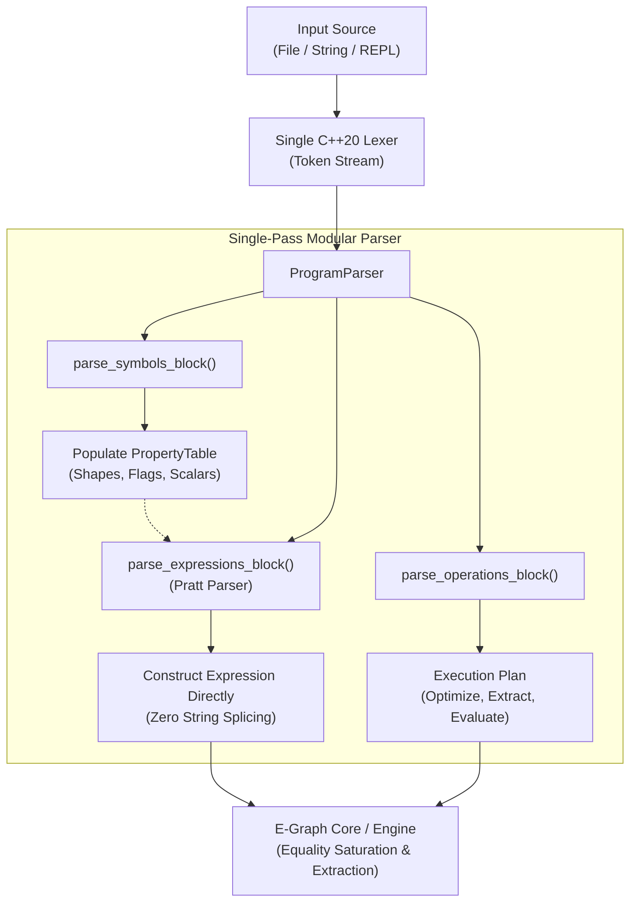

# Structured 3-Block DSL and Unified In-Stream Pratt Parser (Clean-Slate Architecture)

* **Author:** changguo
* **Status:** Proposed
* **Date:** 2026-10-28

--------------------------------------------------------------------------------

## Overview
This design specifies an uncompromised, clean-slate parsing and language architecture for `egraph-cpp`. Centered on a structured 3-block domain-specific language (DSL)—`symbols { ... }`, `expressions { ... }`, and `operations { ... }`—the architecture completely replaces the legacy recursive string-slicing parser with a unified, single-pass C++20 Lexer and Pratt parser. Because this project is pre-release and under active development, **no backwards compatibility constraints are retained**: the intermediate `ParsedAtom` structure, string-based recursive re-parsing, legacy string dimension formats (`100x20`), and functional `Scale(...)` syntax are eliminated. The parser directly outputs fully formed `Expression` and `Pattern` AST trees in a single $O(N)$ pass, with parse-time semantic disambiguation of scalar scaling (`Op::Scale`) versus matrix multiplication (`Op::Mul`).

## The Problem
The legacy parser implementation in `src/common/parser.cpp` suffers from several deep architectural anti-patterns:
1. **$O(N^2)$ Recursive String Re-Parsing**: `parser::parse_expression` returned an intermediate `ParsedAtom` containing `children_strings` (raw substrings). `Expression(std::string_view)` and `Pattern(std::string_view)` then recursively re-lexed and re-parsed each child string from scratch across all tree levels.
2. **Brittle String-Buffering Sub-Parser Hack**: In `Parser::parse_prefix`, encountering `Scale(Matrix, Scalar)` accumulated raw characters into a temporary `std::string scalar_text` until parentheses were balanced, followed by invoking a disconnected secondary `ScalarParser` class.
3. **Identifier Truncation**: `ScalarParser` truncated scalar variable identifiers to a single `char` (`curr.text[0]`), forbidding realistic parameter names like `alpha`, `beta`, or `step_len`.
4. **Lack of Structured Batch Language**: The CLI relied on an imperative, non-reproducible line-by-line command stream (`add properties`, `parse`, `rewrite`, `extract`), lacking a declarative, version-controllable program format.
5. **Syntactic Ambiguity in Infix Arithmetic**: In expressions like `x * y`, the system had no type context to distinguish matrix multiplication from scalar scaling, forcing users into verbose and unidiomatic functional forms like `Scale(A, 2.0)`.

## Goals
* **G1: Formal 3-Block DSL Specification**: Define an authoritative EBNF grammar structuring programs into sequential blocks: `symbols`, `expressions`, and `operations`.
* **G2: Single-Pass Direct AST Construction**: The parser constructs fully formed `Expression` and `Pattern` trees directly in a single $O(N)$ pass, eliminating `ParsedAtom`, `string_to_parsed_atom`, and all recursive string re-parsing.
* **G3: Natural Infix Math & Early Disambiguation**: Allow standard infix mathematical syntax (`2.0 * A`, `A * 2.0`, `alpha * A`, `A * B`), using the `PropertyTable` populated in Block 1 to immediately resolve `Op::Scale` vs. `Op::Mul`.
* **G4: Modernized Multi-Character Scalar Symbols**: Upgrade `ScalarExpr` in `src/core/basic_types.h` to use `std::string` variable identifiers matching the matrix symbol intern table.
* **G5: Clean C++20 Interface**: Standardize `parser::parse_expression` to directly return `Expression`, `parser::parse_pattern` to directly return `Pattern`, and modernize `tests/unit/parser_test.cpp` to assert directly on clean AST structures.

## Non-Goals
* **NG1: No Backwards Compatibility Constraints**: Legacy `ParsedAtom`, string-based recursive parsing, legacy `Matrix(NxM)` string syntax, and verbose `Scale(A, s)` syntax are not retained.
* **NG2: No External Toolchain Dependencies**: No Tree-sitter, ANTLR, Flex/Bison, or Node.js build steps. The implementation remains 100% standard C++20 compiled directly via CMake.
* **NG3: No 1x1 Matrix Memory Allocation for Scalars**: Scalars will not be transformed into 1x1 matrix memory buffers in the E-Graph or BLAS evaluation routines. `ScalarExpr` remains a dedicated closed-form structure to protect the E-Graph from combinatorial state explosion.
* **NG4: No Dynamic Typeless Disambiguation**: The parser will not guess types for undeclared identifiers in concrete user mode; all symbols must be declared in Block 1 (or registered in the `PropertyTable`).

## Resolved Design Decisions
* **D1 (Block Delimiter Semicolons)**: Block delimiters support optional semicolons after closing braces (`symbols { ... }[;]`).
* **D2 (Execution Plan AST)**: Block 3 operations compile into a declarative `ProgramAST` returned to the caller, cleanly decoupling parsing from engine execution.
* **D3 (Direct AST Return)**: `parser::parse_expression` returns `Expression` directly; `parser::parse_pattern` returns `Pattern` directly. `ParsedAtom` is deleted.
* **D4 (Standardized Matrix Notation)**: `Matrix(rows, cols)` is the sole syntax across DSL, CLI, and C++ APIs.

## Critical User Journeys (CUJs)

### CUJ 1: Batch DSL Optimization Script
* **Given**: A declarative script file (`pipeline.eg`) defining matrix properties for `X` and `y`, expressions for Ordinary Least Squares, and an extraction directive.
* **When**: The user executes `egraph_cli run pipeline.eg`.
* **Then**: The engine parses Block 1 to populate the `PropertyTable`, parses Block 2 into validated `Expression` ASTs with automatic `Op::Scale` resolution, and executes Block 3 to output the optimized kernel schedule.

### CUJ 2: Standalone C++ Library Invocation
* **Given**: A C++ application using `egraph::EGraphRunner::Context`.
* **When**: The application defines matrices `A` and `B` in C++ and calls `ctx.optimize_concrete(parse_expression("2.5 * A + B", ctx.get_property_table()))`.
* **Then**: The Pratt parser directly parses the infix expression into an `Expression` tree using the provided `PropertyTable`, canonicalizing `2.5 * A` into `Op::Scale(A, 2.5)` without requiring full-script block wrappers or intermediate string conversions.

### CUJ 3: Static Rewrite Rule Declaration
* **Given**: A static rewrite rule in `src/rule_sets/simplification.h` declaring `"?a * ?b"` or `"?s * ?a"`.
* **When**: The rule set is initialized at startup without an active `PropertyTable`.
* **Then**: The parser operates in `PatternMode`, treating `?`-prefixed tokens as AST wildcards and constructing a `Pattern` tree directly.

--------------------------------------------------------------------------------

## Technical Plan (Architecture)

### Architectural Overview



---

### 1. Formal EBNF Grammar Specification

```ebnf
program             = symbols_block , expressions_block , operations_block ;

symbols_block       = "symbols" , "{" , { symbol_decl } , "}" , [ ";" ] ;
symbol_decl         = identifier , ":" , type_spec , [ property_flags ] , ";" ;
type_spec           = "Matrix" , "(" , dimension , "," , dimension , ")"
                    | "Scalar" ;
dimension           = integer_literal | identifier ;
property_flags      = "[" , identifier , { "," , identifier } , "]" ;

expressions_block   = "expressions" , "{" , { expression_decl } , "}" , [ ";" ] ;
expression_decl     = identifier , "=" , expr , ";" ;

expr                = term , { ( "+" | "-" ) , term } ;
term                = factor , { ( "*" | "/" ) , factor } ;
factor              = prefix_op , factor
                    | primary ;
prefix_op           = "-" ;
primary             = identifier
                    | number_literal
                    | function_call
                    | "(" , expr , ")" ;
function_call       = identifier , "(" , [ expr_list ] , ")" ;
expr_list           = expr , { "," , expr } ;

operations_block    = "operations" , "{" , { operation_decl } , "}" , [ ";" ] ;
operation_decl      = "optimize" , identifier , [ "using" , "rulesets" , "(" , identifier_list , ")" ] , ";"
                    | "extract" , identifier , [ "greedy" ] , [ "with" , "sizes" , "(" , size_binding_list , ")" ] , ";"
                    | "evaluate" , identifier , [ "with" , "data" , "(" , data_binding_list , ")" ] , ";" ;
identifier_list     = identifier , { "," , identifier } ;
size_binding_list   = identifier , "=" , integer_literal , { "," , identifier , "=" , integer_literal } ;
data_binding_list   = data_binding , { "," , data_binding } ;
data_binding        = identifier , "=" , ( string_literal | number_literal ) ;
```

---

### 2. Direct AST Construction & Elimination of `ParsedAtom`

The obsolete intermediate struct `ParsedAtom` and function `string_to_parsed_atom` are completely deleted:

```cpp
// DELETED: struct ParsedAtom { Atom atom; std::vector<std::string> children_strings; };
// DELETED: ParsedAtom string_to_parsed_atom(std::string_view s);
```

Instead, the parser constructs `Expression` and `Pattern` nodes directly from the token stream:

```cpp
// Direct constructors:
Expression::Expression(std::string_view string) {
    *this = parser::parse_expression(string);
}

Pattern::Pattern(std::string_view string) {
    *this = parser::parse_pattern(string);
}
```

---

### 3. Program Parser Engine (`src/common/parser.cpp`)

```cpp
namespace egraph::parser {

struct OptimizeDirective {
    std::string expr_name;
    std::vector<std::string> rulesets;
};

struct ExtractDirective {
    std::string expr_name;
    bool greedy = false;
    std::unordered_map<std::string, int> size_bindings;
};

struct EvaluateDirective {
    std::string expr_name;
    DataBindings data_bindings;
    SizeBindings size_bindings;
};

using OperationDirective = std::variant<OptimizeDirective, ExtractDirective, EvaluateDirective>;

struct ProgramAST {
    PropertyTable property_table;
    std::unordered_map<std::string, Expression> expressions;
    std::vector<OperationDirective> operations;
};

enum class ExprType { Matrix, Scalar, Unknown };

struct ASTNode {
    Atom atom;
    ExprType expr_type = ExprType::Unknown;
    std::vector<std::unique_ptr<ASTNode>> children;
    
    int precedence() const;
    Expression to_expression() const;
    Pattern to_pattern() const;
};

class ProgramParser {
public:
    explicit ProgramParser(std::string_view source, bool pattern_mode = false);
    
    ProgramAST parse_program();
    void parse_symbols_block(PropertyTable &out_pt);
    void parse_expressions_block(const PropertyTable &pt, std::unordered_map<std::string, Expression> &out_exprs);
    void parse_operations_block(std::vector<OperationDirective> &out_ops);
    
    Expression parse_expression(const PropertyTable *pt = nullptr);
    Pattern parse_pattern();

private:
    Lexer lexer;
    Token curr;
    bool pattern_mode = false;
    
    void advance();
    void expect(TokenType type, std::string_view err_msg);
    
    std::unique_ptr<ASTNode> parse_expr(int prec, const PropertyTable *pt);
    std::unique_ptr<ASTNode> parse_prefix(const PropertyTable *pt);
    std::unique_ptr<ASTNode> parse_infix(std::unique_ptr<ASTNode> left, TokenType op, const PropertyTable *pt);
    
    ScalarExpr to_scalar_expr(const ASTNode &node);
};

} // namespace egraph::parser
```

---

### 4. Parse-Time Semantic Disambiguation (`Op::Scale` vs. `Op::Mul`)

When the Pratt parser processes an infix `*` operator (`left * right`), it inspects the operands' inferred `ExprType`:

1. **Bottom-Up Type Propagation**:
   - Number literals and identifiers declared as `Scalar` in `PropertyTable` are assigned `ExprType::Scalar`.
   - Identifiers declared as `Matrix` in `PropertyTable` are assigned `ExprType::Matrix`.
   - Arithmetic operators propagate types: `Scalar (+ | - | *) Scalar` yields `ExprType::Scalar`; `Matrix (+ | -) Matrix` yields `ExprType::Matrix`.
   - Infix division `/` is strictly valid only when both operands are `ExprType::Scalar`, emitting `ScalarOp::Div`. If applied to a matrix, a `ParseError` is thrown immediately.
2. **Disambiguation of `*`**:
   - **Both Operands are Matrices**: Emit standard matrix multiplication `Op::Mul(left, right)`.
   - **Left is Scalar, Right is Matrix**: Automatically rewrite to canonical `Op::Scale(right, to_scalar_expr(left))`.
   - **Left is Matrix, Right is Scalar**: Automatically rewrite to canonical `Op::Scale(left, to_scalar_expr(right))`.
   - **Both Operands are Scalars**: Fold into a composite `ScalarExpr(ScalarOp::Mul, {to_scalar_expr(left), to_scalar_expr(right)})`.
   - **Unary Minus on Matrix**: Canonicalize `-A` directly into `Op::Scale(A, -1.0)`.
   - **Pattern Mode (No PropertyTable)**: Default to `Op::Mul(left, right)`.

---

### 5. Modernized `ScalarExpr` (`src/core/basic_types.h`)

`ScalarExpr` is updated to replace single-character variables with full strings:

```cpp
struct ScalarExpr {
    ScalarOp op = ScalarOp::Value;
    double val = 0.0;
    std::string var; // Upgraded from 'char var = \0;'
    std::vector<ScalarExpr> children;
    
    ScalarExpr() = default;
    explicit ScalarExpr(double v) : op(ScalarOp::Value), val(v) {}
    explicit ScalarExpr(std::string v) : op(ScalarOp::Var), var(std::move(v)) {}
    ScalarExpr(ScalarOp op, std::vector<ScalarExpr> children)
        : op(op), children(std::move(children)) {}
    
    double evaluate(const DataBindings &bindings, const SizeBindings &sizes = {}) const;
    std::string to_string() const;
};
```

---

### 6. Public API Facade (`src/common/parser.h`)

```cpp
namespace egraph::parser {

// Full program parser
ProgramAST parse_program(std::string_view source);

// Expression parser directly returning Expression
Expression parse_expression(std::string_view expr_str, const PropertyTable *pt = nullptr);

// Pattern parser directly returning Pattern
Pattern parse_pattern(std::string_view pattern_str);

} // namespace egraph::parser
```

--------------------------------------------------------------------------------

## Alternatives Considered

### Alternative 1: Retaining `ParsedAtom` for Legacy Backwards Compatibility
* **Description**: Maintain `struct ParsedAtom` with `children_strings` and provide dual APIs (`parse_expression` returning `ParsedAtom` alongside `parse_to_expression` returning `Expression`).
* **Reason for Rejection**: The project is unreleased and under active development. Retaining intermediate string serialization adds ~200 lines of dead adapter code and preserves $O(N^2)$ string re-parsing overhead. Directly constructing `Expression` ASTs is cleaner and significantly faster.

### Alternative 2: Tree-sitter Grammar Generator with CST Lowering Visitor
* **Reason for Rejection**: Over-engineered for a mathematical DSL with ~15 operators. Introduces Node.js and C dependencies for zero runtime benefit.

### Alternative 3: First-Class 1x1 Matrix Expressions for Scalars
* **Reason for Rejection**: Causes severe state-space explosion in E-Graph equality saturation and introduces memory allocation overhead for primitive BLAS scalar arguments (`double alpha, beta`).

--------------------------------------------------------------------------------

## Detailed Implementation Plan

### Target Files to Create / Modify

#### 1. `src/core/basic_types.h` (Modify)
* **Type / Scope**: Core Header / Data Structures
* **Proposed Changes**:
  - Delete `struct ParsedAtom`.
  - In `struct ScalarExpr`, replace `char var = '\0';` with `std::string var;`.
  - Update constructors to accept `std::string`.
  - Use `ScalarOp::Value`.
  - Update `operator==` and `operator<` to compare `std::string var`.

#### 2. `src/common/parser.h` (Modify)
* **Type / Scope**: Core Parser Interface
* **Proposed Changes**:
  - Delete `ParsedAtom parse_expression(...)` and `string_to_parsed_atom(...)`.
  - Define `ProgramAST` and `OperationDirective` variants.
  - Declare clean APIs:
    ```cpp
    ProgramAST parse_program(std::string_view source);
    Expression parse_expression(std::string_view expr_str, const PropertyTable *pt = nullptr);
    Pattern parse_pattern(std::string_view pattern_str);
    ```

#### 3. `src/common/parser.cpp` (Modify)
* **Type / Scope**: Parser & Lexer Implementation
* **Proposed Changes**:
  - Delete `ScalarParser` and string accumulation loops.
  - Implement single-pass Lexer and `ProgramParser`.
  - Implement Pratt parser with bottom-up `ExprType` propagation, emitting `Expression` trees directly.
  - Implement `to_scalar_expr` helper for scalar folding.
  - Implement `parse_symbols_block`, `parse_expressions_block`, and `parse_operations_block`.

#### 4. `src/core/expression.cpp` (Modify)
* **Type / Scope**: Core Expression AST
* **Proposed Changes**:
  - Simplify `Expression::Expression(std::string_view string)` from recursive string splitting to directly calling:
    ```cpp
    *this = parser::parse_expression(string);
    ```

#### 5. `src/rewrite/pattern.cpp` (Modify)
* **Type / Scope**: Pattern Matching Engine
* **Proposed Changes**:
  - Simplify `Pattern::Pattern(std::string_view s)` from recursive string splitting to directly calling:
    ```cpp
    *this = parser::parse_pattern(s);
    ```

#### 6. `src/analysis/property_table.h` and `src/analysis/property_table.cpp` (Modify)
* **Type / Scope**: Analysis Component / Symbol Storage
* **Proposed Changes**:
  - Add `std::unordered_set<std::string> scalar_symbols;`.
  - Add `void add_scalar(std::string name);` and `bool is_scalar(std::string_view name) const;`.
  - Standardize dimension parsing on comma-delimited `Matrix(rows, cols)` everywhere.

#### 7. `src/api.h` (Modify)
* **Type / Scope**: Public Library Runner Context
* **Proposed Changes**:
  - Add `const PropertyTable &get_property_table() const { return egraph.get_property_table(); }` and `PropertyTable &get_property_table() { return egraph.get_property_table(); }` to `Context`.

#### 8. `src/common/utils.h` (Modify)
* **Type / Scope**: Common Utilities & Evaluation
* **Proposed Changes**:
  - Delete `string_to_parsed_atom` wrapper.
  - Update `ScalarExpr::to_string()` and `ScalarExpr::evaluate` to query `DataBindings` using `std::string` keys.

#### 9. `src/cli.cpp` (Modify)
* **Type / Scope**: Interactive CLI & Runner
* **Proposed Changes**:
  - Add `run <file.eg>` command to execute 3-block scripts via `parser::parse_program`.
  - Update REPL to accept block syntax.

#### 10. `tests/unit/parser_test.cpp` (Modify)
* **Type / Scope**: Unit Test Suite
* **Proposed Changes**:
  - Modernize existing tests from asserting on `parsed.children_strings` to asserting directly on `Expression` structure (e.g. `EXPECT_EQ(expr.atom, OpRegistry::op("Add"))`, `EXPECT_EQ(expr.children.size(), 2)`).
  - Add test cases for the 3-block DSL (`symbols`, `expressions`, `operations`).
  - Add test cases for parse-time scalar disambiguation (`2.0 * A`, `A * 2.0`, `alpha * A`).
  - Add test cases for multi-character scalar variables (`alpha`, `batch_size`).
  - Add test cases verifying matrix division throws `ParseError`.

#### 11. `docs/GRAMMAR.md` (Create)
* **Type / Scope**: Documentation / Specification
* **Proposed Changes**:
  - Authoritative EBNF grammar specification for the 3-block DSL.

---

### Verification Plan

* **Compilation & Build**:
  ```bash
  cmake -G Ninja -S . -B build -DCMAKE_BUILD_TYPE=Release
  cmake --build build --target egraph_core_lib egraph_cli unit_tests
  ```
* **Unit & Integration Test Suite**:
  ```bash
  ctest --test-dir build --output-on-failure
  ```
  *Requirement: All modernized and new test cases pass with 100% success rate.*
* **End-to-End CLI Script Verification**:
  ```bash
  ./build/bin/egraph_cli run tests/fixtures/test_pipeline.eg
  ```
* **Memory & Leak Sanitization**:
  ```bash
  cmake -B build_asan -DENABLE_ASAN=ON
  cmake --build build_asan --target unit_tests
  ctest --test-dir build_asan --output-on-failure
  ```

--------------------------------------------------------------------------------

*Drafted with EGM*
