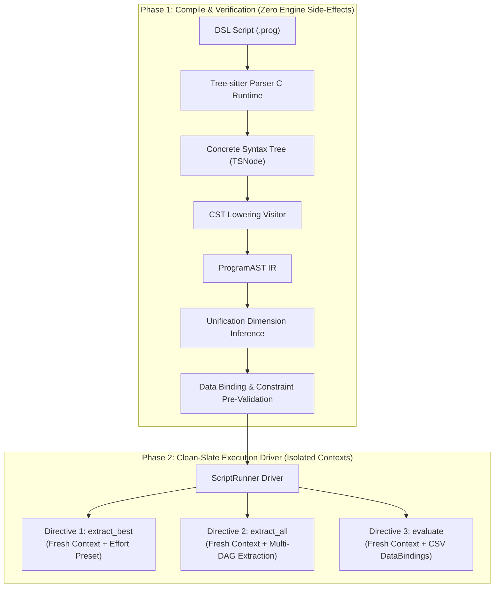
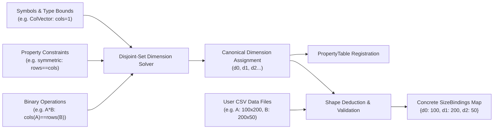

# Technical Design: Symbolic DSL Semantic Lowering Layer & Execution Driver

* **Author:** Engineering Team
* **Date:** 2026-10-29
* **Status:** Finalized

---

## 1. Problem Statement

Linear algebra expression optimization in `egraph-cpp` currently requires writing imperative C++ code or manually constructing e-graph API calls. While a formal grammar (`grammar.ebnf` and `tree-sitter/grammar.js`) has been specified to let users write concise, declarative scripts (defining symbols, mathematical expressions, and operations such as `extract_best`, `extract_all`, and `evaluate`), the system lacks the foundational software layer to execute them.

Specifically, the engine faces three operational bottlenecks:
1. **No Bridge Between Parse Tree and Engine:** The Tree-sitter parser emits an untyped, transient Concrete Syntax Tree (CST). The engine cannot directly translate CST nodes into strongly-typed expression trees or property entries.
2. **Missing Automatic Dimension Inference:** Users declare symbols without explicit row and column dimensions (e.g., `A : Matrix { symmetric }; b : ColVector;`). The internal e-graph analysis tables, cost models, and memory allocations strictly depend on 2D shape dimensions ($M \times N$). Without an automated inference engine that extracts shape constraints from the expressions themselves, declarative scripts cannot be lowered without forcing users to pass tedious, redundant dimension flags.
3. **Absence of a Clean Execution Driver:** When a script defines operations (`extract_best`, `extract_all`, `evaluate`), there is no driver to manage runtime lifecycle. Running operations sequentially inside a shared e-graph mutates internal search state, causes exponential node explosion, and produces non-reproducible cost extraction.

---

## 2. Overview

This design defines the architecture for the **Symbolic DSL Frontend & Execution Driver** (`src/frontend/`). The system introduces a two-phase compilation and execution pipeline:



### Core Architecture Highlights
* **Phase 1 (Compile-Time Validation):** Consumes the Tree-sitter parse tree via C++ RAII wrappers, desugars operators into a strongly-typed `ProgramAST`, runs a disjoint-set unification solver to automatically deduce 2D symbolic shapes (e.g., inferring that in $A \times B$, $cols(A) == rows(B)$), and validates that all required data bindings exist before any engine side-effects take place.
* **Phase 2 (Clean-Slate Execution Driver):** Executes each operation directive in complete isolation using a pristine, freshly initialized `Context`. It maps user-facing effort levels (`low`, `medium`, `high`) onto search budget configurations, drives symbolic rewriting and kernel lowering, and executes complete DAG enumeration or concrete BLAS/LAPACK evaluations using a dedicated matrix CSV reader.

---

## 3. Goals & Non-Goals

### In-Scope Goals
* **Tree-sitter C Runtime Integration:** Link the official Tree-sitter C runtime library (`v0.25.3`) via CMake `FetchContent` (specifying `SOURCE_SUBDIR lib`) to provide parser lifecycle functions (`ts_parser_new`, `ts_tree_delete`, etc.).
* **Typed Semantic AST & Visitor:** Construct a clean, strongly-typed `ProgramAST` decoupling the transient CST from the e-graph, with source location reporting for syntax errors.
* **Structural Dimension Inference & Concrete Size Deduction:** Implement a unification-based disjoint-set solver that deduces 2D matrix/vector dimension variable equivalence (`"d0"`, `"d1"`, `"d2"`...) automatically from properties (`symmetric`, `inv`) and operators (`*`, `+`), and deduces the exact `SizeBindings` map directly from user-provided CSV data bindings without inventing synthetic baseline numbers.
* **Isolated Operation Lifecycle:** Guarantee that every operation directive (`extract_best`, `extract_all`, `evaluate`) runs in an isolated `Context` to prevent cross-directive search contamination.
* **Bounded Multi-DAG Enumeration:** Expose `extract_all` on `Context` to completely enumerate distinct surviving algorithm DAGs on the pruned e-graph, enforcing a default safety ceiling (50 DAGs).
* **Production CSV Matrix I/O:** Promote test CSV reading into a production reader (`src/io/matrix_reader.h`) that auto-deduces rows/columns and validates rectangular memory layout.
* **Effort Presets:** Map categorical effort levels (`low`, `medium`, `high`) directly onto `EGraphConfig` parameters.

### Out-of-Scope Non-Goals
* **Arbitrary N-D Tensors:** The engine and frontend remain strictly focused on 2D matrices, column/row vectors, and scalars.
* **Interactive REPL Shell Integration:** The lowering layer and `ScriptRunner` provide programmatic and batch-script execution APIs; interactive REPL wiring will be addressed in a subsequent milestone.
* **Standalone C++ Code Generation:** Extraction returns optimized `Expression` trees and kernel choices; emitting standalone C++ source code files is out of scope for this layer.

---

## 4. Technical Architecture & Component Design

The technical design partitions the frontend and execution logic into modular, highly decoupled subsystems:

```
src/
├── frontend/
│   ├── ts_wrapper.h            # RAII wrappers for Tree-sitter parser, tree, and nodes
│   ├── ast.h                   # Strongly-typed Semantic AST definitions
│   ├── cst_lowering.h/.cpp     # Visitor translating CST TSNode -> ProgramAST
│   ├── dim_inference.h/.cpp    # Disjoint-set symbolic dimension inference solver
│   └── script_runner.h/.cpp    # Isolated execution coordinator for directives
├── io/
│   └── matrix_reader.h/.cpp    # Production CSV/text matrix reader & layout transposer
├── common/
│   └── egraph_config.h/.cpp    # Effort-level presets and configuration scaling
└── api.h                       # Multi-DAG extraction method added to Context
```

---

### Component 1: Tree-sitter C Runtime Linking & RAII Wrapper (`src/frontend/ts_wrapper.h`)

Tree-sitter uses raw C pointers (`TSParser*`, `TSTree*`) that require manual heap reclamation. To prevent memory leaks during script parsing, RAII wrappers encapsulate the parser and syntax tree:

```cpp
namespace egraph::frontend {

class TSTreeWrapper {
public:
    explicit TSTreeWrapper(TSTree *tree) : tree_(tree) {}
    ~TSTreeWrapper() { if (tree_) ts_tree_delete(tree_); }
    TSTreeWrapper(const TSTreeWrapper &) = delete;
    TSTreeWrapper &operator=(const TSTreeWrapper &) = delete;
    TSTreeWrapper(TSTreeWrapper &&o) noexcept : tree_(std::exchange(o.tree_, nullptr)) {}
    
    TSNode root() const { return ts_tree_root_node(tree_); }
    bool has_error() const { return ts_node_has_error(root()); }

private:
    TSTree *tree_ = nullptr;
};

class TSParserWrapper {
public:
    TSParserWrapper();
    ~TSParserWrapper() { if (parser_) ts_parser_delete(parser_); }
    TSTreeWrapper parse_string(std::string_view source);

private:
    TSParser *parser_ = nullptr;
};

} // namespace egraph::frontend
```

*Build System Change:* Root `CMakeLists.txt` pulls `tree-sitter/tree-sitter` `v0.25.3` via `FetchContent` with `SOURCE_SUBDIR lib` (as the library's `CMakeLists.txt` resides in `lib/`), exports `${tree_sitter_SOURCE_DIR}/lib/include` to provide header definitions (`tree_sitter/api.h`), and links `tree-sitter` to `egraph_core_lib`.

---

### Component 2: Strongly-Typed Semantic AST (`src/frontend/ast.h`)

The semantic AST cleanly decouples the transient, string-based Tree-sitter CST from the downstream e-graph engine. Source locations (`line`, `column`) are preserved for high-fidelity error reporting:

```cpp
namespace egraph::frontend {

enum class SymbolKind { Matrix, Scalar, ColVector, RowVector };
enum class EffortLevel { Low, Medium, High };

// Source location using 1-indexed line and column numbers (converted from Tree-sitter's 0-indexed TSPoint).
struct SourceLocation {
    uint32_t line = 1;
    uint32_t column = 1;
};

struct SymbolDeclAST {
    std::string name;
    SymbolKind kind;
    std::vector<std::string> property_flags;
    // Populated during the dimension inference pass:
    std::variant<int, std::string> canonical_rows = "d0";
    std::variant<int, std::string> canonical_cols = "d1";
    SourceLocation loc;
};

struct ExprDeclAST {
    std::string name;
    Expression expr;
    // Inline property refinements, e.g. for X { symmetric }: var_name -> list of flags
    std::unordered_map<std::string, std::vector<std::string>> inline_properties;
    SourceLocation loc;
};

struct ExtractDirectiveAST {
    bool extract_all = false; // false = extract_best, true = extract_all
    std::string target_variable;
    EffortLevel effort = EffortLevel::Medium;
    std::unordered_map<std::string, std::string> data_bindings; // var -> csv_path (mandatory)
    SourceLocation loc;
};

struct EvaluateDirectiveAST {
    std::string target_variable;
    EffortLevel effort = EffortLevel::Medium;
    std::unordered_map<std::string, std::string> data_bindings; // var -> csv_path (mandatory)
    SourceLocation loc;
};

using OperationAST = std::variant<ExtractDirectiveAST, EvaluateDirectiveAST>;

struct ProgramAST {
    std::vector<SymbolDeclAST> symbols;
    std::vector<ExprDeclAST> expressions;
    std::vector<OperationAST> operations;
};

} // namespace egraph::frontend
```

---

### Component 3: CST Lowering Visitor (`src/frontend/cst_lowering.h/.cpp`)

The lowering visitor translates named CST nodes into `ProgramAST`.
1. **Error Detection:** Performs a pre-pass across the syntax tree. If `ts_node_is_error(node)` or `ts_node_is_missing(node)` is encountered, it queries line and column coordinates using `ts_node_start_point()`, converts them to 1-indexed coordinates (`line = point.row + 1`, `column = point.column + 1`), and throws a descriptive `SyntaxError`.
2. **Block Processing:**
   * `symbols_block`: Maps identifier, type keywords (`Matrix`, `ColVector`, etc.), and property flags (`symmetric`, `positive_definite`) into `SymbolDeclAST`.
   * `expressions_block`: Recursively lowers mathematical subtrees:
     * Binary `+` and `-` $\to$ `Op::Add` and desugared subtraction `Op::Add(L, Op::Scale(R, -1.0))` (or engine minus).
     * Binary `*` $\to$ `Op::Mul`.
     * Binary `/`: If the right-hand operand is a scalar (e.g. constant `2.0`), it is desugared to `Op::Scale(L, 1.0 / scalar)`. If applied to a matrix divisor, the lowering visitor throws a `CompileError("Direct matrix division is unsupported; express via inv() or linear solve")`.
     * Unary `-` $\to$ `Op::Scale(expr, -1.0)`.
     * `trans(e)` $\to$ `OpRegistry::op("Tr")` (`"Tr"` is the registered transpose operator in `egraph-cpp`).
     * `inv(e)` $\to$ `OpRegistry::op("Inv")`.
     * Primary with inline properties (`X { symmetric }`): Validated against the declaration of `X` in `symbols_block`. If compatible, it refines the `PropertyTable` entry for `X`; if contradictory (e.g. `X` declared as rectangular `tall` but used inline as `{ symmetric }`), lowering fails with a compile-time conflict error.
   * `operations_block`: Extracts directives (`extract_best`, `extract_all`, `evaluate`), mapping optional `effort` and mandatory data-binding key-value pairs (`{ var = "path.csv" }`). All directives require data bindings so concrete matrix shapes are deduced for cost model evaluation and execution. If data bindings are omitted or incomplete for any directive, lowering fails with a compile-time error (`"missing required data_bindings for operation directive"`).
3. **Topological Expression Inlining Pass:**
   In scripts where expressions reference earlier named expressions (e.g., `e1 = A * B; e2 = e1 + C;`), `e1` initially appears as a leaf identifier. A topological sort across `expressions_block` detects any cyclic definitions and substitutes/inlines upstream expression DAGs into downstream targets. This ensures that only declared symbols from `symbols_block` enter dimension inference and the e-graph.

---

### Component 4: Unification-Based Symbolic Dimension Inference Engine (`src/frontend/dim_inference.h/.cpp`)

Users do not specify dimensions in declarative scripts. Instead, 2D dimensions are inferred through a unification-based constraint solver:



#### Constraint Solver Mechanics (Disjoint-Set Union-Find)
1. **Dimension Variable Allocation:** Every symbol is allocated a row dimension variable (`DimVarId`) and a column dimension variable.
2. **Structural Equivalence Unification:**
   * `ColVector`: Unifies column dimension with concrete integer constant `1`.
   * `RowVector`: Unifies row dimension with concrete integer constant `1`.
   * `Scalar`: Unifies both row and column dimensions with concrete constant `1`.
   * Square properties (`symmetric`, `diagonal`, `orthogonal`, `identity`, `positive_definite`, and `inv(A)`): Unifies `rows == cols`.
   * Matrix multiplication `A * B`: Unifies `cols(A) == rows(B)`.
   * Matrix addition `A + B`: Unifies `rows(A) == rows(B)` and `cols(A) == cols(B)`.
3. **Contradiction Detection:** If two conflicting concrete dimensions attempt to unify (e.g. multiplying an $M \times 3$ matrix by an $M \times 4$ matrix, or adding a column vector to an incompatible matrix), the solver throws a `DimensionMismatchError` detailing the exact conflicting variable chain.
4. **Deterministic Canonical Symbol Generation:** To guarantee reproducible runs across toolchains, free dimension equivalence classes are sorted deterministically by the source order of first appearance of their symbols in the script. Equivalence classes are then sequentially assigned canonical dimension variable names (`"d0"`, `"d1"`, `"d2"`...). Inferred shapes are populated in `SymbolDeclAST` and registered in `PropertyTable`.
5. **Deduction of Concrete SizeBindings from Mandatory DataBindings:** In `egraph-cpp`, extraction evaluates kernel cost models which require concrete numeric sizes for every dimension. Because data bindings are mandatory for all directives (`extract_best`, `extract_all`, and `evaluate`), the system never needs to invent or synthesize arbitrary baseline dimensions (such as $N=1000$). Instead, the driver inspects the concrete CSV shapes provided in the directive's `data_bindings`, validates that they satisfy all symbolic dimension equivalences, and directly deduces the exact `SizeBindings` map for the extraction cost model and evaluation.

---

### Component 5: Production Matrix CSV Reader (`src/io/matrix_reader.h/.cpp`)

Promoted from test utilities into a core engine module:
* **Format Agnostic:** Parses comma-, space-, or tab-delimited plain text files.
* **Rectangular Integrity:** Verifies that every row in the file has an identical column count, throwing `std::runtime_error` on jagged data.
* **Layout Transposition:** Data in standard CSV files is stored row-major. BLAS, LAPACK, and `Evaluator` strictly require **column-major** layout. The reader automatically transposes values into column-major `std::vector<double>`.
* **Binding Validation & Size Deduction:** When any directive (`extract_best`, `extract_all`, `evaluate`) is invoked, the reader opens the referenced files, extracts concrete $(M, N)$ dimensions, validates rectangularity and structural constraints against the inferred dimension equivalence classes, and constructs the concrete `SizeBindings` map required by `Extractor` and `Evaluator`.

```cpp
namespace egraph::io {

struct MatrixData {
    int rows = 0;
    int cols = 0;
    std::vector<double> data; // Column-major layout
};

MatrixData read_matrix(const std::string &filename);
void write_matrix(
    const std::string &filename,
    int rows,
    int cols,
    const std::vector<double> &col_major_data,
    int precision = 17);

} // namespace egraph::io
```

---

### Component 6: Search Budget & Effort Presets (`src/common/egraph_config.h`)

The grammar's `effort_level` (`low`, `medium`, `high`) is mapped onto `EGraphConfig`:

```cpp
namespace egraph {

void apply_effort_preset(EGraphConfig &config, frontend::EffortLevel level) {
    switch (level) {
    case frontend::EffortLevel::Low:
        config.rewrite.node_limit = 2000;
        config.rewrite.enable_backoff = true;
        config.pruner.num_iterations = 1;
        config.pruner.rewrite_steps_per_iteration = 4;
        config.pruner.prune_samples_per_iteration = 50;
        config.pruner.dag_visit_limit = 2000;
        config.extractor.max_depth = 25;
        config.extractor.node_visit_limit = 100000;
        config.extractor.seeding_attempts = 2;
        break;

    case frontend::EffortLevel::Medium:
        config.rewrite.node_limit = 8000;
        config.rewrite.enable_backoff = true;
        config.pruner.num_iterations = 2;
        config.pruner.rewrite_steps_per_iteration = 8;
        config.pruner.prune_samples_per_iteration = 100;
        config.pruner.dag_visit_limit = 10000;
        config.extractor.max_depth = 40;
        config.extractor.node_visit_limit = 5000000;
        config.extractor.seeding_attempts = 5;
        break;

    case frontend::EffortLevel::High:
        config.rewrite.node_limit = 35000;
        config.rewrite.enable_backoff = true;
        config.pruner.num_iterations = 4;
        config.pruner.rewrite_steps_per_iteration = 16;
        config.pruner.prune_samples_per_iteration = 250;
        config.pruner.dag_visit_limit = 50000;
        config.extractor.max_depth = 60;
        config.extractor.node_visit_limit = 50000000;
        config.extractor.seeding_attempts = 15;
        break;
    }
}

// Updated signature in egraph_config.h/.cpp:
// If an effort preset is active, initialize_config_for_expression scales its heuristic thresholds
// proportionally instead of unconditionally wiping out the configured budgets.
void initialize_config_for_expression(
    EGraphConfig &config, const Expression &expr, std::optional<frontend::EffortLevel> effort = std::nullopt);

} // namespace egraph
```

---

### Component 7: Engine API Extension: Multi-DAG Extraction (`src/api.h`)

`Extractor` already contains the numeric search method `find_top_numeric_dags` capable of finding multiple lowest-cost DAGs. We expose `extract_all` directly on `Context`:

```cpp
std::vector<ExtractionResult> extract_all(Id target_id, size_t max_results = 50, const SizeBindings &bindings = {}) {
    if (config.enable_logging) {
        std::cout << "[API] Extracting all expressions (limit " << max_results << ") for target " << target_id << "...\n";
    }
    Extractor extractor(egraph, config);
    return extractor.extract(target_id, max_results, bindings);
}

// Overload defaulting to root_expression:
std::vector<ExtractionResult> extract_all(size_t max_results = 50, const SizeBindings &bindings = {}) {
    return extract_all(root_expression, max_results, bindings);
}
```

---

### Component 8: Clean-Slate Script Runner Execution Driver (`src/frontend/script_runner.h/.cpp`)

The `ScriptRunner` orchestrates script execution, enforcing **pristine context isolation** for every operation directive:

```cpp
namespace egraph::frontend {

struct ScriptExecutionReport {
    struct ExtractResult {
        std::string target;
        Expression optimal_expr;
        Cost cost;
    };
    struct ExtractAllResult {
        std::string target;
        std::vector<std::pair<Expression, Cost>> results;
    };
    struct EvaluateResult {
        std::string target;
        std::vector<double> numerical_data;
        std::chrono::microseconds execution_time;
    };

    std::vector<std::variant<ExtractResult, ExtractAllResult, EvaluateResult>> directive_results;

    void add_extract(std::string target, const ExtractionResult &res) {
        directive_results.push_back(ExtractResult{std::move(target), res.expr, res.cost});
    }

    void add_extract_all(std::string target, const std::vector<ExtractionResult> &results) {
        ExtractAllResult all;
        all.target = std::move(target);
        for (const auto &r : results) {
            all.results.emplace_back(r.expr, r.cost);
        }
        directive_results.push_back(std::move(all));
    }

    void add_evaluate(std::string target, std::vector<double> data, std::chrono::microseconds duration) {
        directive_results.push_back(EvaluateResult{std::move(target), std::move(data), duration});
    }
};

class ScriptRunner {
public:
    static ScriptExecutionReport run_script(std::string_view dsl_source);
    static ScriptExecutionReport run_file(const std::string &filepath);
};

} // namespace egraph::frontend
```

#### Per-Directive Isolation Loop
```cpp
using namespace egraph::EGraphRunner;

for (const auto &op : program_ast.operations) {
    // 1. Fresh Context instantiation per directive (no search contamination)
    Context ctx;
    
    // 2. Configure effort search budgets
    frontend::EffortLevel effort = get_effort(op);
    apply_effort_preset(ctx.get_config(), effort);
    
    // 3. Register inferred symbols & properties
    for (const auto &sym : program_ast.symbols) {
        // Unpack variant rows/cols (integer constant or symbolic variable name)
        if (std::holds_alternative<int>(sym.canonical_rows) && std::holds_alternative<int>(sym.canonical_cols)) {
            ctx.define_matrix(sym.name, std::get<int>(sym.canonical_rows), std::get<int>(sym.canonical_cols), sym.property_flags);
        } else if (std::holds_alternative<std::string>(sym.canonical_rows) && std::holds_alternative<std::string>(sym.canonical_cols)) {
            ctx.define_matrix(sym.name, std::get<std::string>(sym.canonical_rows), std::get<std::string>(sym.canonical_cols), sym.property_flags);
        } else if (std::holds_alternative<std::string>(sym.canonical_rows)) {
            ctx.define_matrix(sym.name, std::get<std::string>(sym.canonical_rows), std::get<int>(sym.canonical_cols), sym.property_flags);
        } else {
            ctx.define_matrix(sym.name, std::get<int>(sym.canonical_rows), std::get<std::string>(sym.canonical_cols), sym.property_flags);
        }
    }
    
    // 4. Resolve expression (with upstream intermediate expressions already inlined)
    std::string target_name = get_target_name(op);
    const Expression &target_expr = lookup_expr(program_ast, target_name);
    
    // 5. Load CSV data bindings and deduce concrete size bindings from data files
    DataBindings data_bindings;
    SizeBindings size_bindings;
    load_and_validate_bindings(op, program_ast, data_bindings, size_bindings);
    
    // 6. Rewrite and lower
    ctx.optimize_symbolic(target_expr, {}, {"everything_but_lowering"}, effort);
    ctx.lower_to_kernels();

    // 7. Execute targeted directive with concrete size bindings
    if (is_extract_best(op)) {
        auto res = ctx.extract(ctx.get_target_id(), size_bindings);
        report.add_extract(target_name, res);
    } else if (is_extract_all(op)) {
        auto all_res = ctx.extract_all(ctx.get_target_id(), /*max_results=*/50, size_bindings);
        report.add_extract_all(target_name, all_res);
    } else if (is_evaluate(op)) {
        auto eval_res = ctx.evaluate_concrete(ctx.get_target_id(), size_bindings, data_bindings);
        report.add_evaluate(target_name, std::move(eval_res), ctx.get_last_evaluation_duration());
    }
}
```

---

## 5. Alternatives Considered

| Alternative | Mechanism | Why It Was Rejected |
| :--- | :--- | :--- |
| **1. Shared `Context` Across Directives** | Reusing a single `Context` and `EGraph` instance across all operations in a script. | **Search state pollution and node explosion:** Rewrites triggered by `extract_best(e1)` introduce thousands of expanded nodes into the e-graph. When `extract_all(e2)` runs subsequently, its extraction cost baseline is distorted and memory consumption compounds. Clean-slate isolation guarantees deterministic, reproducible runs. |
| **2. Mandatory User-Specified Dimensions in `symbols`** | Requiring users to specify dimension identifiers explicitly (e.g. `A : Matrix(n, k); B : Matrix(k, m);`). | **Excessive cognitive overhead and boilerplate:** Algebraic operations already dictate dimension equality (e.g., $cols(A) == rows(B)$ in $A \times B$, or $rows == cols$ for symmetric matrices). Unification inference automatically solves dimension equivalence while catching structural mismatches before runtime. |
| **3. Direct `TSNode` Traversal without an Intermediate AST** | Directly driving e-graph insertion and execution from Tree-sitter C nodes without an intermediate `ProgramAST`. | **Brittle lifetime coupling:** `TSNode` references transient C memory owned by `TSTree`. Bypassing a strongly-typed AST prevents multi-pass validation, AST-level dimension unification, and clean unit testing of the lowering visitor. |
| **4. Unbounded `extract_all` Enumeration** | Exhaustively enumerating every possible DAG combination without an upper-bound result limit. | **Combinatorial latency spikes:** Even on a pruned e-graph, graphs with multiple alternative factorization orders can produce hundreds of permutation DAGs. Enforcing a default safety ceiling (50 DAGs) ensures bounded execution time and memory predictability. |
| **5. On-Demand Synthetic Data for `evaluate`** | Automatically generating random synthetic matrices when data file bindings are omitted. | **Silent correctness hazards:** Users running `evaluate` expect numerical validation against known datasets (e.g., benchmark CSVs). Silently fabricating inputs masks user configuration errors. Strict compile-time validation ensures data integrity. |

---

## 6. Detailed Implementation Plan

The implementation proceeds in six sequential phases. Each phase establishes a tested, independent component before integrating with downstream stages:

### Phase 1: Build System & Tree-sitter Runtime Linkage
1. Pull Tree-sitter C runtime library (`v0.25.3`) using `FetchContent` in root `CMakeLists.txt`.
2. Link `tree-sitter` runtime and `symbolic_dsl_parser` into `egraph_core_lib`.
3. Implement `src/frontend/ts_wrapper.h/.cpp` with RAII classes (`TSParserWrapper`, `TSTreeWrapper`) to prevent C pointer leaks.
4. Verify with basic unit tests parsing test snippets and verifying `has_error()` detection.

### Phase 2: AST Definitions & CST Lowering Visitor
1. Define the strongly-typed `ProgramAST` in `src/frontend/ast.h`.
2. Implement `src/frontend/cst_lowering.h/.cpp`:
   - Walk named CST nodes (`symbols_block`, `symbol_decl`, `expressions_block`, `expression_decl`, `operations_block`, `extract_call`, `evaluate_call`).
   - Extract source coordinates for syntax errors (`ts_node_start_point`).
   - Desugar binary expressions (`+`, `-`, `*`), unary negation, `trans()`, `inv()`, and inline property flags.
3. Validate lowering visitor with all 13 regression test cases from the language specification.

### Phase 3: Unification-Based Dimension Inference Engine
1. Implement `DimensionSolver` in `src/frontend/dim_inference.h/.cpp` using a disjoint-set union-find data structure.
2. Implement dimension unification passes:
   - Fixed bounds: `ColVector` ($cols=1$), `RowVector` ($rows=1$), `Scalar` ($1 \times 1$).
   - Algebraic constraints: $cols(A) == rows(B)$ for multiplication; $rows(A) == cols(A)$ for `symmetric`, `inv()`, etc.
   - Contradiction detection: Throw `DimensionMismatchError` when conflicting bounds collide.
3. Implement canonical symbol assignment: Map disjoint root equivalence classes to sequential canonical dimension variables (`"d0"`, `"d1"`, `"d2"`...).
4. Update symbols in `PropertyTable` with canonical shapes.

### Phase 4: Production Matrix CSV Reader
1. Create `src/io/matrix_reader.h/.cpp` (promoted from `tests/support/test_helpers.h`).
2. Implement delimited parser supporting comma, space, and tab separators.
3. Verify rectangular column consistency across all rows.
4. Implement automatic in-memory transposition from row-major file format to column-major memory layout.
5. Add compile-time data-binding pre-validator: Verify that all leaf variables in target expressions exist in the mandatory data binding map, and deduce the concrete `SizeBindings` map from file dimensions.

### Phase 5: Search Budget Presets & Multi-DAG Extraction
1. Implement `apply_effort_preset(EGraphConfig&, EffortLevel)` in `src/common/egraph_config.cpp`.
2. Expose `extract_all(Id target_id, size_t max_results, const SizeBindings&)` on `Context` in `src/api.h`.
3. Integrate cycle-safe top-$K$ DAG search on the pruned e-graph, enforcing a default ceiling of 50 DAGs.

### Phase 6: Clean-Slate Execution Driver (`ScriptRunner`)
1. Implement `src/frontend/script_runner.h/.cpp`:
   - End-to-end coordinator: Ingests DSL string or file, runs CST lowering, executes dimension inference, and loops over operation directives.
   - Enforce clean-slate `Context` isolation per operation directive.
   - Dispatch `extract_best`, `extract_all`, and `evaluate` execution using concrete `SizeBindings` deduced from CSV files.
   - Package results into structured `ScriptExecutionReport`.
2. Add end-to-end integration tests in `tests/integration/script_runner_test.cpp`.

---

## 7. File Manifest & Rationale

| File Path | Action | Rationale |
| :--- | :--- | :--- |
| `CMakeLists.txt` | **Modify** | Add `FetchContent` declaration for `tree-sitter` runtime (`v0.25.3`). |
| `src/CMakeLists.txt` | **Modify** | Add `src/frontend/` and `src/io/` sources to `egraph_core_lib` and link `tree-sitter` runtime. |
| `src/frontend/ts_wrapper.h` | **Create** | RAII C++ wrappers managing `TSParser*` and `TSTree*` lifecycles to prevent memory leaks. |
| `src/frontend/ts_wrapper.cpp` | **Create** | Implementation initializing Tree-sitter language grammar `tree_sitter_symbolic_dsl()`. |
| `src/frontend/ast.h` | **Create** | Strongly-typed `ProgramAST`, `SymbolDeclAST`, `ExprDeclAST`, and `OperationAST` definitions. |
| `src/frontend/cst_lowering.h` | **Create** | Header for CST lowering visitor translating `TSNode` to `ProgramAST`. |
| `src/frontend/cst_lowering.cpp` | **Create** | Implementation traversing Tree-sitter CST nodes, desugaring arithmetic, and reporting syntax errors. |
| `src/frontend/dim_inference.h` | **Create** | Disjoint-set union-find dimension solver and inference pass interfaces. |
| `src/frontend/dim_inference.cpp` | **Create** | Implementation solving 2D shape constraints and assigning canonical dimension names (`"d0"`, `"d1"`, `"d2"`...). |
| `src/io/matrix_reader.h` | **Create** | Header for production matrix CSV/text file reader. |
| `src/io/matrix_reader.cpp` | **Create** | Implementation parsing delimited files, verifying rectangular shapes, and converting to column-major memory. |
| `src/common/egraph_config.h` | **Modify** | Declare `apply_effort_preset` function. |
| `src/common/egraph_config.cpp` | **Modify** | Implement search budget scaling for `low`, `medium`, and `high` effort levels. |
| `src/api.h` | **Modify** | Expose `extract_all` method on `Context` to return top-$K$ distinct DAG alternatives. |
| `src/frontend/script_runner.h` | **Create** | Interface for top-level `ScriptRunner` executing `.prog` scripts with clean-slate context isolation. |
| `src/frontend/script_runner.cpp` | **Create** | Implementation driving compilation, dimension inference, and isolated directive execution. |
| `tests/unit/dim_inference_test.cpp` | **Create** | Unit tests verifying symbolic dimension unification, vector constraints, and mismatch errors. |
| `tests/unit/matrix_reader_test.cpp` | **Create** | Unit tests for CSV file reading, column-major transposition, and jagged-row validation. |
| `tests/support/test_helpers.h` | **Modify** | Include and alias production `src/io/matrix_reader.h` to eliminate duplicate matrix loading logic across test harnesses. |
| `tests/integration/script_runner_test.cpp` | **Create** | End-to-end integration tests executing scripts with `extract_best`, `extract_all`, and `evaluate`. |
| `tests/CMakeLists.txt` | **Modify** | Register new unit and integration test suites in CMake build. |
